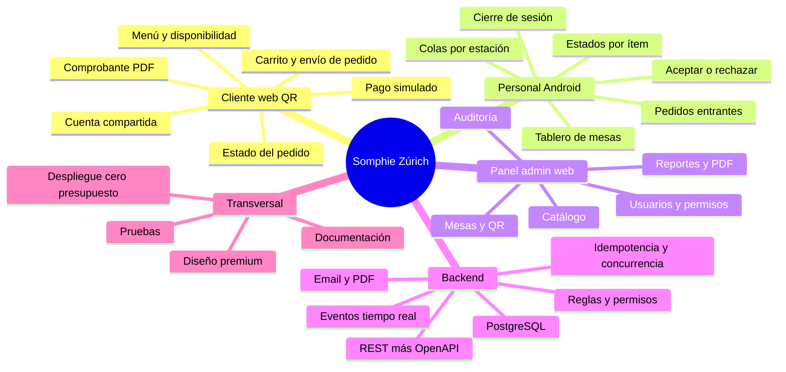

# Somphie Zúrich — Sistema integral de gestión de cafetería

> **Documentación v0.2 — Fase 0 (Especificación funcional).** Incluye las decisiones D-101…D-159 y las preguntas Q-01…Q-20 resueltas (Q-21 sigue pendiente); el resumen de v0.2 está en `docs/00-gobierno/cambios-v0.2.md`.
> Estado: **borrador para validación del dueño del proyecto**. Nada de lo descrito está implementado todavía.
> Idioma de los documentos: español. Idioma del código, API y base de datos: inglés (ver D-103).
> **¿Retomas el trabajo o eres un agente nuevo?** Lee primero `docs/00-gobierno/advances.md`: estado actual, decisiones D-142…D-159, plan paso a paso y bitácora.

## 1. Qué es este repositorio

Somphie Zúrich es una cafetería elegante con un sistema que conecta tres experiencias sobre un backend común:

| Experiencia | Quién la usa | Tecnología | Carpeta |
|---|---|---|---|
| **Web cliente** (QR de mesa) | Clientes, sin instalar nada | React + TypeScript | `web/` (rutas `/`) |
| **App del personal** | Mozos, barra, cocina | Kotlin + Jetpack Compose | `android/` |
| **Panel de administración** | Dueño / supervisor | React + TypeScript | `web/` (rutas `/admin`, carga diferida) |
| **Backend** | Todos los anteriores | Spring Boot + Kotlin + PostgreSQL | `backend/` |

**Principio rector:** el backend decide, los clientes muestran. Ningún cliente decide si un pedido fue aceptado, si un pago es válido o si una cuenta se puede cerrar.

**Núcleo demostrable (flujo vertical mínimo):**
`QR → menú → pedido persistido → aceptación del personal → preparación por estación → cuenta compartida → pago simulado → cierre`

## 2. Mapa del repositorio

```
somphie-zurich/
├── README.md                  ← este archivo (índice)
├── AGENTS.md                  ← reglas universales para cualquier agente o colaborador
├── docs/
│   ├── 00-gobierno/           decisiones (aceptadas/propuestas/pendientes) y ADRs
│   ├── 01-producto/           visión, alcance, actores y roles, glosario
│   ├── 02-dominio/            modelo, estados, reglas, casos de uso, casos límite, errores, datos
│   ├── 03-arquitectura/       contexto, backend, secuencias, seguridad, tiempo real, concurrencia
│   ├── 04-api/                openapi.yaml (contrato), convenciones, endpoints (borrador previo), eventos, changelog
│   ├── 05-diseno/             sistema visual y mapa de pantallas
│   ├── 06-pruebas/            estrategia y criterios de aceptación
│   ├── 07-despliegue/         entorno local y nube/CI-CD
│   └── 08-agentes/            guía por agente, dependencias entre agentes y roadmap por fases
├── backend/AGENTS.md          ← puntero a docs/08-agentes/backend.md
├── web/AGENTS.md              ← puntero a docs/08-agentes/web.md
├── android/AGENTS.md          ← puntero a docs/08-agentes/android.md
├── design/img/                marca: ic_icon.png, logos (ver README interno)
└── infra/                     docker-compose, scripts (Fase 2)
```

## 3. Orden de lectura

| Si eres… | Lee primero | Luego |
|---|---|---|
| **El dueño del proyecto (tú)** | `00-gobierno/decisiones.md` → `01-producto/*` → `02-dominio/estados-y-transiciones.md` | todo lo demás |
| **Agente Backend** | `AGENTS.md` → `08-agentes/backend.md` | `02-dominio/*` completo, `03-arquitectura/*`, `04-api/*` |
| **Agente Web** | `AGENTS.md` → `08-agentes/web.md` | `02-dominio/casos-de-uso.md`, `catalogo-errores.md`, `04-api/*`, `05-diseno/*` |
| **Agente Android** | `AGENTS.md` → `08-agentes/android.md` | `02-dominio/estados-y-transiciones.md`, `casos-de-uso.md`, `04-api/*`, `05-diseno/*` |
| **Agente UX/UI** | `08-agentes/ux-ui.md` | `01-producto/*`, `05-diseno/*`, `02-dominio/casos-de-uso.md` |
| **Agente QA** | `08-agentes/qa.md` | `06-pruebas/*`, `02-dominio/casos-limite.md`, `reglas-negocio.md` |
| **Agente DevOps** | `08-agentes/devops.md` | `07-despliegue/*`, `03-arquitectura/contexto.md` |
| **Arquitecto / orquestador** | `08-agentes/arquitecto.md` | todo |

Para saber **quién depende de quién y cuándo**: `docs/08-agentes/dependencias.md` y `roadmap-fases.md`.

## 4. Convenciones de identificadores

| Prefijo | Significado | Dónde vive |
|---|---|---|
| `D-xxx` | Decisión | `00-gobierno/decisiones.md` |
| `Q-xx` | Pregunta pendiente | `00-gobierno/decisiones.md` |
| `ADR-xxxx` | Decisión de arquitectura | `00-gobierno/adr/` |
| `RN-MOD-nn` | Regla de negocio | `02-dominio/reglas-negocio.md` |
| `CU-nn` | Caso de uso | `02-dominio/casos-de-uso.md` |
| `CL-nnn` | Caso límite | `02-dominio/casos-limite.md` |
| `ERROR_CODE` | Código de error de negocio | `02-dominio/catalogo-errores.md` |
| `EV-nombre` | Evento en tiempo real | `04-api/eventos.md` |
| `SC-x-nn` | Pantalla (C cliente, S staff, A admin) | `05-diseno/mapa-pantallas.md` |
| `WP-AGENTE-nn` | Paquete de trabajo | `08-agentes/roadmap-fases.md` |
| `AC-CU-nn-x` | Criterio de aceptación | `06-pruebas/criterios-aceptacion.md` |

## 5. Estado de las decisiones

- ✅ **Confirmada**: la definiste tú en el plan maestro.
- 🟢 **Aceptada en chat**: la propuse y la aprobaste.
- 🟡 **Propuesta**: la propuse en este paquete; **requiere tu validación**.
- 🔴 **Pendiente**: falta información o criterio para decidir.

## 6. Mapa conceptual del producto



## 7. Cómo proponer cambios

1. Lee `docs/00-gobierno/decisiones.md` → sección *Protocolo de cambios*.
2. Cambios de reglas/estados/errores/API se hacen **primero en docs** y después en código.
3. Si algo no está especificado, **no lo inventes**: abre una consulta (`Q-xx`) y sigue con otra tarea.
