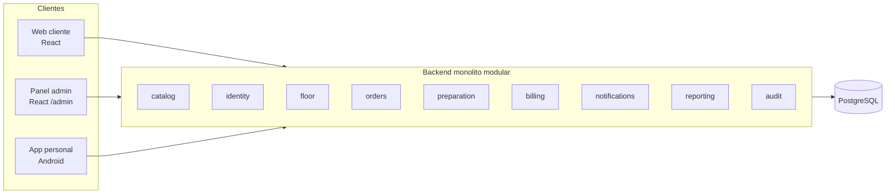

# Alcance

## 1. Priorización (MoSCoW) y fase de entrega

**M** = Debe (MVP) · **S** = Debería · **C** = Podría · **W** = No por ahora

| Área | Funcionalidad | Prioridad | Fase |
|---|---|---|---|
| Catálogo | Ver menú por categorías, productos, precio, imagen, disponibilidad, alérgenos | M | 3 |
| Catálogo | Notas por ítem (≤140) | M | 4 |
| Catálogo | Opciones/modificadores con precio (Q-02) | S | 3b |
| Mesas | QR por mesa, abrir/unirse a sesión, token invitado, código de sesión | M | 4 |
| Mesas | Revocar participantes, rotar código | S | 4 |
| Pedidos | Crear, cancelar pendiente, ver estado, historial, expiración | M | 4 |
| Pedidos | Aceptar / rechazar / aceptar con exclusiones | M | 4–5 |
| Preparación | Colas por estación, estados por ítem, entrega | M | 5 |
| Preparación | Deshacer transiciones, cancelar ítem | S | 5 |
| Personal | Login, tablero de mesas, disponibilidad de productos | M | 5 |
| Personal | Abrir sesión manual, tomar pedido en nombre del cliente | S | 5/7 |
| Tiempo real | SSE + reconexión + dedupe | M | 6 |
| Cuenta | Cuenta compartida con precios históricos, saldo | M | 7 |
| Pagos | Pago simulado total/parcial, historial, anulación, reembolso, efectivo | M | 7 |
| Cuenta | Divisor de cuenta (solo UI) | S | 7 |
| Cierre | Cierre de sesión con reglas y cierre forzado auditado | M | 7 |
| PDF | Comprobante no fiscal | M | 7 |
| Admin | CRUD catálogo, imágenes, mesas y QR, usuarios y roles | M | 8 |
| Admin | Reportes y exportación PDF | S | 8 |
| Admin | Auditoría consultable, ajustes del local | S | 8 |
| Extras | Registro/login de clientes por email + verificación | S | 9 |
| Extras | Email de comprobante | S | 9 |
| Extras | Encuesta posterior | S | 9 |
| Extras | Llamar al mozo (Q-10) | C | 9 |
| Extras | Retiro por mostrador | C | 9 |
| Extras | Push (FCM) para app cerrada | C | posterior |
| Extras | Sonido/vibración en nuevos pedidos (Android) | C | 6 |
| Plataforma | Despliegue nube + demo + README | M | 2 (esqueleto) y 10 |
| Fuera | Pagos reales, tarjetas | W | — |
| Fuera | Delivery | W | — |
| Fuera | Multiempresa SaaS | W | — (modelo preparado con `restaurant_id`) |
| Fuera | Facturación fiscal | W | — |
| Fuera | Asignación de ítems por persona para dividir | W | posterior |
| Fuera | Stock real / inventario | W | Q-12 |
| Fuera | Propinas, descuentos | 🔴 | Q-01, Q-03 |

## 2. Mapa de módulos y apps

## 3. Puntos de extensión previstos (la arquitectura los permite, no se implementan)
| Extensión futura | Qué ya está preparado |
|---|---|
| Más sucursales | `restaurant_id` en todas las tablas; permisos con alcance por restaurante |
| Delivery / retiro | `Order.fulfillment_type` (`DINE_IN` ahora) |
| Pagos reales | Puerto `PaymentProvider`; hoy `SimulatedPaymentProvider` |
| Dividir por ítem | `OrderItem` ya es una línea con id propio; `Payment` puede referenciar líneas más adelante |
| Push | Puerto `PushSender`; hoy no-op |
| Más roles | Roles = datos |

## 4. Enmiendas v0.2 (tus respuestas a Q-01…Q-14)

| Funcionalidad | Prioridad | Fase |
|---|---|---|
| Opciones/modificadores de producto con precio | **M** | 3 |
| Propina libre | **M** | 7 |
| Descuentos, cortesías y ajustes manuales | **S** | 7 |
| Internacionalización web cliente (es-AR + en; de después) | **S** | 2 (infra) / 3 |
| Llamar al mozo (incluye "pedir la cuenta") | **S** | 9 (adelantable tras la 6) |
| Imágenes en carpeta (puerto `ImageStorage`) | **M** | 3 |
| Multi-sucursal simulada (aislamiento por `restaurant_id` + pruebas) | **S** | 4 |
| Comandas impresas | W | posterior |
| Stock real | W | posterior |
