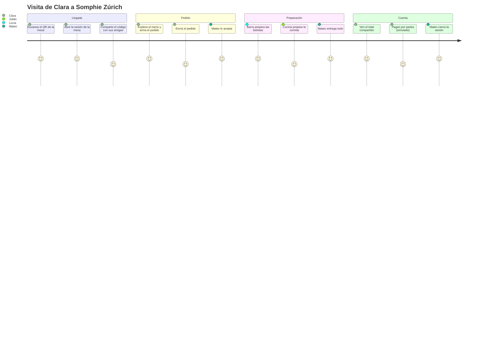

# Visión del producto

## 1. Propósito
Conectar en una sola plataforma la experiencia del cliente, la operación diaria del personal y la gestión del negocio de **Somphie Zúrich**, una cafetería de especialidad elegante, cálida y contemporánea.

## 2. Propuesta de valor
| Para… | Valor |
|---|---|
| **Cliente** | Pedir desde la mesa, sin instalar nada, sin esperar al mozo, con la cuenta siempre clara y compartible |
| **Personal** | Una cola de trabajo ordenada por estación; menos gritos, menos papelitos, menos errores |
| **Dueño** | Control de catálogo, operación y números; trazabilidad de todo lo importante |
| **Portfolio** | Evidencia de diseño, arquitectura, pruebas, seguridad, concurrencia y despliegue en un producto realista |

## 3. Personas de referencia
| Persona | Rol | Necesidad principal | Dolor actual |
|---|---|---|---|
| **Clara**, 29, llega con dos amigas | Cliente invitada | Pedir rápido, ver cuánto va la cuenta, pagar su parte | Esperar al mozo; dividir la cuenta a mano |
| **Mateo**, 24 | Mozo | Saber qué mesa pidió qué y qué está listo para llevar | Pedidos de papel perdidos; olvidar entregas |
| **Lucía**, 31 | Barista (barra) | Ver solo bebidas, en orden de llegada | Comandas mezcladas con comida |
| **Julián**, 38 | Cocina | Ver solo comida, con notas visibles | Que marquen "listo" un pedido que aún tiene comida pendiente |
| **Sofía**, 45 | Dueña | Cambiar precios, apagar productos agotados, ver ventas | Depender de terceros para cualquier cambio |

## 4. Recorrido principal (resumen)

## 5. Principios de diseño del producto
1. **El backend decide.** Los clientes muestran.
2. **Mesa ≠ Sesión ≠ Pedido ≠ Ítem ≠ Cuenta ≠ Participante.** Nunca se mezclan (ver dominio).
3. **Nada se borra en silencio:** rechazos, cancelaciones y anulaciones quedan en historial y auditoría.
4. **Fricción mínima para el cliente, control suficiente para el local.**
5. **Premium es consistencia y claridad**, no cantidad de animaciones.
6. **Primero que funcione de punta a punta, después que sea sofisticado.**

## 6. Métricas de éxito (de portfolio, medibles)
| Métrica | Objetivo |
|---|---|
| Flujo QR → pedido enviado | ≤ 90 s con menú ya conocido, ≤ 4 toques para repetir un pedido |
| Demo completa (QR→cierre) | Reproducible por un tercero en < 5 min con README |
| Pruebas | Dominio ≥ 90 % de líneas; casos de uso críticos con integración sobre PostgreSQL real |
| Concurrencia | 0 duplicados en pruebas de carga de doble envío/pago/aceptación |
| Rendimiento web cliente | LCP < 2,5 s en móvil gama media 4G; JS inicial < 200 KB gzip |
| Rendimiento Android | Arranque en frío < 2 s; listas a 60 fps en dispositivo de referencia |
| Accesibilidad | Contraste AA, objetivos táctiles ≥ 44 px (web) / 48 dp (Android) |

## 7. Supuestos
- Un solo local con ~10–25 mesas; personal de 2 a 8 personas.
- Conectividad Wi-Fi/4G razonable pero **no perfecta** (se diseña para reintentos).
- Moneda ARS; zona horaria `America/Argentina/Buenos_Aires`.
- No hay integración con fiscalidad (comprobantes **no fiscales**).
