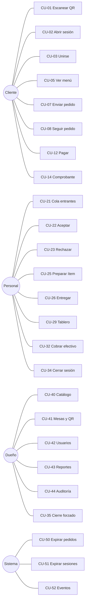

# Casos de uso

Cada caso lista: **Actor**, **Permiso**, **Precondiciones**, **Flujo**, **Alternativas/errores** (con `ERROR_CODE` de `catalogo-errores.md`), **Efectos**, **Idempotencia**, y las referencias a **endpoint** (`endpoints.md`), **pantallas** (`mapa-pantallas.md`) y **fase**.
Reglas relacionadas: `reglas-negocio.md`. Criterios de aceptación: `06-pruebas/criterios-aceptacion.md` (`AC-CU-nn-x`).

## Índice

| Grupo | Casos |
|---|---|
| Cliente | CU-01 … CU-14 |
| Personal | CU-20 … CU-36 |
| Administración | CU-40 … CU-45 |
| Sistema | CU-50 … CU-53 |
| Extras | CU-60 … CU-63 |

---
# A. Cliente

### CU-01 — Escanear QR y resolver la mesa
- **Actor:** visitante anónimo · **Permiso:** público · **Fase:** 4
- **Pre:** QR impreso con `tableCode`.
- **Flujo:** 1) Abre `/t/{tableCode}`. 2) La web llama `GET /public/tables/{tableCode}`. 3) Recibe `{tableLabel, restaurantId, restaurantOpen, hasActiveSession, canOpen}` (`restaurantId` permite pedir el menú del local correcto, D-144). 4) Si hay token guardado y válido para esa sesión → CU-04. Si no hay sesión → ofrece CU-02. Si hay sesión → pide código (CU-03).
- **Errores:** `TABLE_CODE_INVALID` (QR viejo/regenerado) → pantalla "Este QR ya no es válido, avisá al personal"; `TABLE_UNAVAILABLE`; `RESTAURANT_CLOSED` (muestra menú de solo lectura).
- **Nota:** el menú se puede **ver** sin abrir sesión (solo lectura); abrir sesión se pide al primer intento de pedir.
- **Pantallas:** SC-C-01.

### CU-02 — Abrir sesión de mesa (primer escaneo)
- **Actor:** visitante · **Permiso:** `session.open` · **Fase:** 4
- **Pre:** mesa activa, sin sesión `OPEN`, local abierto.
- **Flujo:** 1) El usuario ingresa su nombre (≤30). 2) `POST /public/tables/{tableCode}/sessions {displayName}`. 3) Servidor crea sesión `OPEN`, participante `HOST`, `joinCode` y token. 4) Responde `{session, participant, guestToken, joinCode}`. 5) La web guarda el token y muestra el código para compartir.
- **Alternativas:** carrera con otro escaneo → `409 SESSION_ALREADY_OPEN` → la web pasa a CU-03. `requireStaffToOpenSession=true` → queda esperando confirmación del personal (🟡).
- **Efectos:** `SESSION_OPENED` auditado; `EV-session.updated`; tablero del personal muestra mesa `OCCUPIED`. Quien abre por QR es el `HOST`; en sesiones abiertas por el personal rige CU-30 (RN-ACC-14).
- **Idempotencia:** `Idempotency-Key` obligatorio; un reintento devuelve la misma sesión (no crea otra).
- **Pantallas:** SC-C-02.

### CU-03 — Unirse a una sesión con código
- **Actor:** visitante · **Permiso:** `session.join` · **Fase:** 4
- **Pre:** sesión `OPEN` en la mesa.
- **Flujo:** nombre + código de 6 caracteres → `POST /public/tables/{tableCode}/join {displayName, joinCode}` → participante + token. El rol es `MEMBER`, salvo que la sesión aún no tenga `HOST` (abierta por el personal, CU-30): el primero en unirse pasa a ser `HOST` (RN-ACC-14). Si dos se unen a la vez, uno queda `HOST` y el otro `MEMBER`, **sin error** (RN-ACC-15, D-143).
- **Errores:** `JOIN_CODE_REQUIRED`, `JOIN_CODE_INVALID`, `JOIN_CODE_RATE_LIMITED` (muestra espera), `SESSION_FULL`, `SESSION_CLOSED`.
- **Pantallas:** SC-C-03.

### CU-04 — Retomar sesión (reanudar)
- **Actor:** participante · **Permiso:** token válido · **Fase:** 4
- **Flujo:** al abrir la web con token guardado → `GET /sessions/current`. Si responde OK → entra directo al menú/pedidos.
- **Alternativas:** `SESSION_CLOSED` → SC-C-13 "visita finalizada" (con comprobante si hay lectura); `SESSION_ACCESS_REVOKED` → "Te quitaron el acceso, pedí el código otra vez"; `TOKEN_REVOKED`/`UNAUTHENTICATED` → borra token y vuelve a CU-01.

### CU-05 — Consultar el menú
- **Actor:** cualquiera · **Permiso:** `menu.read` · **Fase:** 3
- **Flujo:** `GET /menu` (con `If-None-Match`). Sin token se envía `restaurantId` (o el servidor usa el predeterminado del despliegue; id desconocido → `404`, RN-TEN-03). Muestra categorías, productos, precio, imagen, alérgenos, "Agotado".
- **Errores/estados:** sin conexión → muestra último menú en caché con aviso; vacío (sin productos) → estado vacío; error → reintentar.
- **Pantallas:** SC-C-04/05/06.

### CU-06 — Armar el carrito (local)
- **Actor:** participante · **Fase:** 3 (datos simulados), 4 (real)
- **Flujo:** agregar/quitar/cambiar cantidad, nota por ítem. El total mostrado es **estimación** (`estimatedTotalMinor`).
- **Reglas de UI:** respeta límites (cantidad máx.); si un producto pasa a "Agotado" al refrescar el menú, el carrito lo marca y bloquea el envío.
- **Persistencia:** el carrito vive en el dispositivo, atado a la sesión, y se vacía al cerrar la sesión.
- **Pantallas:** SC-C-07.

### CU-07 — Enviar un pedido
- **Actor:** participante · **Permiso:** `order.create` · **Fase:** 4
- **Pre:** sesión `OPEN`, carrito no vacío, local abierto.
- **Flujo:** 1) Revisa y confirma. 2) La web genera `Idempotency-Key` **una sola vez por intento de envío**. 3) `POST /sessions/current/orders {items[], note?, acknowledgedTotalMinor}`. 4) Servidor, en una transacción: bloquea sesión `FOR SHARE`, valida producto/disponibilidad/límites, calcula precios, compara total, crea pedido + ítems con snapshot, `displayCode`, auditoría. 5) Responde `201 {order}`. 6) La web vacía el carrito y muestra estado (SC-C-08). 7) Se notifica al personal.
- **Alternativas/errores:** `PRICE_CHANGED` (la web muestra nuevos precios y pide reconfirmar → reenvía con nuevo total y **nueva** clave), `PRODUCT_UNAVAILABLE` (lista ids; marca el carrito), `ORDER_PENDING_LIMIT_REACHED`, `SESSION_CLOSED`, `RESTAURANT_CLOSED`, `VALIDATION_FAILED`, `RATE_LIMITED`, red caída → **reintento con la misma clave** (no crea duplicado), `IDEMPOTENCY_KEY_REUSED` (misma clave con otro cuerpo: bug de cliente).
- **Efectos:** `ORDER_CREATED`; `EV-order.created`.
- **Idempotencia:** obligatoria; replay devuelve la respuesta original con `Idempotent-Replayed: true`.

### CU-08 — Seguir el estado del pedido
- **Actor:** participante · **Permiso:** `bill.read`/pertenencia · **Fase:** 4 (polling), 6 (SSE)
- **Flujo:** `GET /sessions/current/orders` y `GET /orders/{id}`. Muestra estado general y por ítem, con quién lo pidió, motivo si se rechazó, y aviso si hubo exclusiones.
- **Estados mostrados:** ver tabla de etiquetas en `mapa-pantallas.md` §6.
- **Errores:** `ORDER_NOT_FOUND` (otra sesión → 404).

### CU-09 — Cancelar un pedido pendiente
- **Actor:** autor o host · **Permiso:** `order.cancel_own` · **Fase:** 4
- **Flujo:** `POST /orders/{id}/cancel` → `CANCELLED`.
- **Errores:** `ORDER_NOT_CANCELLABLE` (ya decidido: la UI refresca y explica), `FORBIDDEN`.
- **Idempotencia:** natural (si ya está cancelado por la misma acción → `200` con estado actual).

### CU-10 — Corregir y reenviar tras rechazo o expiración
- **Actor:** participante · **Fase:** 4
- **Flujo:** desde SC-C-08 con pedido `REJECTED`/`EXPIRED`: botón "Corregir y reenviar" → vuelve a cargar los ítems al carrito (los no disponibles se marcan) → CU-07 con **nueva** clave. El pedido rechazado **permanece** en el historial.

### CU-11 — Ver la cuenta de la sesión
- **Actor:** participante · **Permiso:** `bill.read` · **Fase:** 7
- **Flujo:** `GET /sessions/current/bill` → `{charges, paid, balance, lines[], payments[], pendingOrdersNotIncluded[]}`.
- **Nota:** los pedidos pendientes se muestran aparte ("no incluido aún").

### CU-12 — Pagar (simulado, total o parcial)
- **Actor:** participante · **Permiso:** `payment.create` · **Fase:** 7
- **Pre:** sesión `OPEN`; `balance > 0` (salvo pago solo propina con cargos, D-146).
- **Flujo:** 1) Elige "Pagar todo" / monto libre / "Mi parte" (divisor UI). El mínimo es `min(minPaymentMinor, saldo)`: si el saldo es chico, se paga exactamente el saldo (D-158). 2) Confirma pantalla de pago simulado (sin campos de tarjeta). 3) `POST /sessions/current/payments {amountMinor, method:"SIMULATED_ONLINE"}` + `Idempotency-Key`. 4) Servidor: bloquea sesión `FOR UPDATE`, recalcula saldo, valida, crea pago, recalcula. 5) Responde `201 {payment, bill}`.
- **Errores:** `PAYMENT_AMOUNT_INVALID`, `PAYMENT_EXCEEDS_BALANCE` (incluye saldo actual → la UI ajusta), `PAYMENT_NOTHING_TO_PAY`, `PAYMENT_DECLINED` (demo), `SESSION_CLOSED`.
- **Concurrencia:** dos participantes pagando a la vez se serializan; el segundo ve el saldo ya reducido.
- **Efectos:** `PAYMENT_CREATED`; `EV-bill.updated`.

### CU-13 — Gestionar participantes (host)
- **Actor:** host · **Permiso:** `participant.manage` · **Fase:** 4
- **Flujo:** ver lista; `DELETE /sessions/current/participants/{id}` (revocar); `POST /sessions/current/join-code/rotate`.
- **Errores:** `HOST_CANNOT_BE_REVOKED`, `PARTICIPANT_NOT_FOUND`.

### CU-14 — Descargar el comprobante
- **Actor:** participante (lectura 24 h) · **Fase:** 7
- **Flujo:** `GET /sessions/current/receipt.pdf` (solo `CLOSED`) → PDF no fiscal.
- **Errores:** `RECEIPT_NOT_AVAILABLE` (sesión abierta), `TOKEN_EXPIRED` (pasaron 24 h).

---
# B. Personal

### CU-20 — Iniciar sesión (personal)
- **Actor:** personal · **Fase:** 4 (backend) / 5 (Android)
- **Flujo:** `POST /auth/login` → `{accessToken, refreshToken, user, permissions, stations}`. La app arma sus pestañas desde `permissions`. Refresh automático al recibir `TOKEN_EXPIRED`.
- **Errores:** `INVALID_CREDENTIALS` (mensaje genérico), `ACCOUNT_DISABLED`, `ACCOUNT_TEMPORARILY_LOCKED`; contraseña temporal → obliga cambio.

### CU-21 — Ver la cola de pedidos entrantes
- **Permiso:** `order.read` · **Fase:** 5
- **Flujo:** `GET /staff/orders?status=PENDING_REVIEW` ordenados por antigüedad; muestra mesa, `#código`, autor, ítems, notas, disponibilidad actual, tiempo esperando (resalta cerca del TTL).

### CU-22 — Aceptar un pedido (con exclusiones opcionales)
- **Permiso:** `order.accept` · **Fase:** 4 (API) / 5 (UI)
- **Flujo:** 1) Abre detalle. 2) Opcional: marca ítems a excluir con motivo. 3) `POST /staff/orders/{id}/accept {excludedItems?:[{itemId, reason}]}` + `Idempotency-Key`. 4) Servidor: actualización condicional `PENDING_REVIEW → ACCEPTED`; ítems → `QUEUED`/`CANCELLED`; auditoría; evento.
- **Errores:** `ORDER_ALREADY_DECIDED` (otro empleado ganó: la app muestra quién y qué decidió), `ORDER_EXPIRED` (el estado ya es `EXPIRED`), `ORDER_ALL_ITEMS_EXCLUDED`, `FORBIDDEN`. Superar el TTL sin que el job haya cambiado el estado no impide aceptar.
- **Efectos:** aparecen ítems en las colas de sus estaciones; el cliente ve "Aceptado".

### CU-23 — Rechazar un pedido
- **Permiso:** `order.reject` · **Fase:** 4/5
- **Flujo:** `POST /staff/orders/{id}/reject {reasonCode, reasonText?}`.
- **Errores:** `ORDER_ALREADY_DECIDED`, `ORDER_EXPIRED` si el estado actual ya es `EXPIRED`.
- **Efectos:** pedido `REJECTED`, ítems `CANCELLED`, el cliente ve motivo y puede corregir (CU-10).

### CU-24 — Ver la cola de una estación
- **Permiso:** `item.prepare` (o `order.read` limitado) · **Fase:** 5
- **Flujo:** `GET /staff/stations/{stationId}/queue` → ítems `QUEUED`/`IN_PREPARATION` de pedidos aceptados, FIFO, con `delayed`, mesa, nota. Un usuario solo ve estaciones asignadas.

### CU-25 — Iniciar / marcar listo un ítem
- **Permiso:** `item.prepare` + estación · **Fase:** 5
- **Flujo:** `POST /staff/order-items/{id}/start` o `/ready` (+ `Idempotency-Key`). Recalcula estado del pedido en la misma transacción.
- **Errores:** `ITEM_INVALID_TRANSITION`, `ITEM_STATION_FORBIDDEN`, `SESSION_CLOSED`.

### CU-26 — Entregar ítems
- **Permiso:** `item.deliver` · **Fase:** 5
- **Flujo:** desde detalle de mesa o pedido: "Entregar" por ítem o "Entregar todo lo listo" (lote). `POST /staff/order-items/{id}/deliver`; para lote `POST /staff/orders/{id}/deliver-ready`.
- **Efectos:** cuando todo está entregado, pedido `DELIVERED`.

### CU-27 — Cancelar un ítem
- **Permiso:** `order.cancel` · **Fase:** 5
- **Flujo:** `POST /staff/order-items/{id}/cancel {reason}`.
- **Errores:** `ITEM_NOT_CANCELLABLE` (entregado), `VALIDATION_FAILED` (sin motivo).
- **Efectos:** el cargo baja; si el saldo queda < 0 el tablero marca "a favor" → CU-33.

### CU-28 — Revertir un estado
- **Permiso:** `item.undo` · **Fase:** 5
- **Flujo:** `POST /staff/order-items/{id}/undo`. `ITEM_UNDO_WINDOW_EXPIRED` si se intenta deshacer una entrega pasados 5 min.

### CU-29 — Ver el tablero de mesas
- **Permiso:** `table.read` · **Fase:** 5
- **Flujo:** `GET /staff/tables` → mesas con `displayStatus` derivado, cantidad de pendientes, saldo (desde F7).

### CU-30 — Abrir una sesión desde el personal
- **Permiso:** `session.open_manual` · **Fase:** 5 (D-114)
- **Flujo:** `POST /staff/tables/{tableId}/sessions {hostLabel?}` → sesión `OPEN` con `joinCode` que el mozo puede dictar, **sin HOST** (D-143). Los clientes se unen con CU-03 y el primero en unirse pasa a ser `HOST`; hasta entonces el personal puede revocar participantes y rotar el código (RN-ACC-10, RN-ACC-14).
- **Errores:** `SESSION_ALREADY_OPEN`, `TABLE_UNAVAILABLE`.

### CU-31 — Tomar un pedido en nombre del cliente
- **Permiso:** `order.create_on_behalf` · **Fase:** 7 (D-113)
- **Flujo:** `POST /staff/sessions/{id}/orders` → pedido auto-`ACCEPTED`, auditado con actor. Útil para clientes sin móvil.

### CU-32 — Registrar un pago en efectivo
- **Permiso:** `payment.register_cash` · **Fase:** 7
- **Flujo:** `POST /staff/sessions/{id}/payments {amountMinor, payerLabel?}` con `Idempotency-Key`. Mismas validaciones de saldo que CU-12.

### CU-33 — Anular un pago / registrar un reembolso
- **Permiso:** `payment.void` / `payment.refund` · **Fase:** 7
- **Flujo:** `POST /staff/payments/{id}/void {reason}`; `POST /staff/sessions/{id}/refunds {amountMinor, reason}`.
- **Errores:** `PAYMENT_NOT_VOIDABLE`, `REFUND_EXCEEDS_PAID`.

### CU-34 — Cerrar una sesión
- **Permiso:** `session.close` · **Fase:** 7
- **Flujo:** 1) La app muestra checklist (pendientes, ítems en curso, saldo). 2) `POST /staff/sessions/{id}/close`. 3) Servidor bloquea sesión `FOR UPDATE`, comprueba reglas RN-SES-05, cierra, invalida joinCode, deja tokens en solo lectura, audita, notifica.
- **Errores:** `SESSION_HAS_PENDING_ORDERS`, `SESSION_HAS_ACTIVE_ITEMS`, `SESSION_BALANCE_PENDING` (devuelven detalle de qué falta), `SESSION_CLOSED` (ya cerrada: idempotente → `200` con estado).
- **Efectos:** mesa pasa a `FREE`; `EV-session.closed`; comprobante disponible.

### CU-35 — Cierre forzado
- **Permiso:** `session.force_close` · **Fase:** 7
- **Flujo:** `POST /staff/sessions/{id}/force-close {reason}` (motivo obligatorio).
- **Efectos:** cancela pendientes e ítems activos; audita `SESSION_FORCE_CLOSED`; comprobante marcado. Los pagos y propinas ya registrados **se conservan**. Si el saldo queda < 0, el sistema registra en la misma transacción un **reembolso simulado automático** por el exceso (sin propina), auditado; si queda > 0, se anota como **saldo no cobrado** en la auditoría y el comprobante (RN-SES-06, D-159).

### CU-36 — Alternar disponibilidad de un producto
- **Permiso:** `availability.toggle` · **Fase:** 5
- **Flujo:** `PATCH /staff/products/{id}/availability {available}`. Cambia `catalogVersion`; evento `EV-catalog.updated`.

---
# C. Administración (panel web)

### CU-40 — Gestionar categorías y productos
- **Permiso:** `catalog.manage` · **Fase:** 8
- **Flujo:** CRUD con orden, precio, estación, alérgenos, imagen (+alt), archivar. `CATEGORY_NOT_EMPTY`, `PRODUCT_NAME_DUPLICATE`, `IMAGE_INVALID`.

### CU-41 — Gestionar mesas y QR
- **Permiso:** `table.manage` · **Fase:** 8
- **Flujo:** alta/edición/desactivar mesas; **regenerar** `tableCode`; generar/imprimir QR (hoja con etiqueta). `TABLE_HAS_OPEN_SESSION`, `TABLE_LABEL_DUPLICATE`.

### CU-42 — Gestionar usuarios, roles y estaciones
- **Permiso:** `user.manage` · **Fase:** 8
- **Flujo:** crear personal (contraseña temporal), asignar rol/estaciones, deshabilitar. `LAST_OWNER_PROTECTED`, `USER_NOT_FOUND`.

### CU-43 — Ver reportes y exportar PDF
- **Permiso:** `report.read` / `report.export` · **Fase:** 8
- **Contenido mínimo:** ventas por día/rango, productos más vendidos, pedidos por hora, tiempo medio de preparación por estación, tasa de rechazo/expiración, ticket promedio, ocupación de mesas.

### CU-44 — Consultar auditoría
- **Permiso:** `audit.read` · **Fase:** 8
- **Flujo:** `GET /admin/audit-events` con filtros (acción, actor, objetivo, fecha), paginado por cursor.

### CU-45 — Configurar el local
- **Permiso:** `settings.manage` · **Fase:** 8
- **Flujo:** horario, límites y TTLs, `requireStaffToOpenSession`, nombre y datos para el comprobante. `SETTINGS_INVALID`.

---
# D. Sistema

### CU-50 — Expirar pedidos pendientes
- **Job** cada minuto: `PENDING_REVIEW` con `createdAt + TTL <= now` → `EXPIRED` (actualización condicional, segura ante carreras con otras decisiones), audita `ORDER_EXPIRED`, emite evento. El dominio rechaza como error de programación una invocación antes del TTL; un pedido decidido ya no se modifica.

### CU-51 — Expirar sesiones vacías
- **Job** cada minuto: sesiones `OPEN` sin pedidos pendientes ni cargos y sin actividad `sessionIdleTtlMin` → `CLOSED(EXPIRED_EMPTY)`.

### CU-52 — Emitir eventos en tiempo real
- Tras *commit*, escribe en `event_log` y publica por SSE (ver `tiempo-real.md`). Falla de emisión ≠ falla de negocio.

### CU-53 — Enviar email
- Puerto `EmailSender`; usado para comprobante y verificación (F9). Reintentos con tope; no bloquea la operación.

---
# E. Extras (Fase 9, 🟡)

| CU | Nombre | Resumen |
|---|---|---|
| CU-60 | Registro, verificación y login de cliente | `POST /auth/register`, `/auth/verify-email`, `/auth/login`; vincular participante a cuenta; historial y comprobantes |
| CU-61 | Encuesta posterior | Valoración 1–5 + comentario tras el cierre; asociada a la sesión; una por participante |
| CU-62 | Llamar al mozo | Evento "llamado" visible en tablero del personal (Q-10) |
| CU-63 | Retiro por mostrador | `fulfillmentType=PICKUP`, sin mesa; flujo reducido (Q-02/D-025) |

---
# F. Enmiendas y casos nuevos de la v0.2

## Enmiendas a casos existentes
- **CU-05/06 (menú y carrito):** los productos con `optionGroups` abren una hoja de selección; respetar `required`, `min/max` y valores por defecto. El total estimado suma los deltas. El menú respeta el idioma elegido (RN-I18N).
- **CU-07 (enviar pedido):** cada línea lleva `optionIds[]`. Errores nuevos: `OPTION_NOT_FOUND`, `OPTION_UNAVAILABLE`, `OPTION_SELECTION_INVALID`.
- **CU-12 (pagar):** el participante puede agregar una **propina libre** (`tipMinor`) o pagar solo propina. Errores nuevos: `TIP_INVALID`, `TIP_EXCEEDS_LIMIT`, `TIP_NOT_ALLOWED`. El saldo no incluye la propina. Un pago solo propina no exige `balance > 0` (D-146) y el mínimo del monto principal es `min(minPaymentMinor, saldo)` (D-158).
- **CU-11 (cuenta):** muestra ajustes (con etiqueta genérica) y propinas aparte.
- **CU-24/25 (colas):** el ítem muestra `optionsSummary`.
- **CU-32 (efectivo):** admite propina.
- **CU-36 (disponibilidad):** también para **opciones**.

### CU-37 — Aplicar descuento, cortesía o ajuste
- **Permiso:** `adjustment.apply` / `adjustment.apply_any` · **Fase:** 7
- **Flujo:** desde SC-S-08 elige tipo, monto/porcentaje o ítem, motivo → `POST /staff/sessions/{id}/adjustments` + `Idempotency-Key`. Servidor: lock `FOR UPDATE`, calcula importe, valida límite y saldo, registra, audita.
- **Errores:** `ADJUSTMENT_INVALID`, `ADJUSTMENT_EXCEEDS_BALANCE`, `ADJUSTMENT_LIMIT_EXCEEDED` (el límite del Mozo es **acumulado**: 15 % de los cargos brutos, D-142; sugiere pedir al Dueño), `ADJUSTMENT_ITEM_INVALID`, `SESSION_CLOSED`.

### CU-38 — Anular un ajuste
- **Permiso:** `adjustment.void` · **Fase:** 7 · `POST /staff/adjustments/{id}/void {reason}`. Errores: `ADJUSTMENT_NOT_VOIDABLE`, `FORBIDDEN`.

### CU-46 — Gestionar grupos de opciones y traducciones (admin)
- **Permiso:** `catalog.manage` · **Fase:** 8
- **Flujo:** CRUD de grupos y opciones, asignación a productos, orden, traducciones por idioma. Cambios incrementan `catalogVersion`.

### CU-47 — Cambiar el idioma (web cliente)
- **Fase:** 3 · selector `es-AR`/`en`; se guarda en `localStorage`; recarga el menú con `Accept-Language`; el carrito se conserva por `productId`.

### CU-62 — Llamar al mozo (detalle)
- **Actor:** participante · **Permiso:** `waiter_call.create` · **Fase:** 9 (adelantable tras la 6)
- **Flujo:** botón "Llamar al mozo" con motivos (Pedir la cuenta, Agua, Ayuda, Otro) → `POST /sessions/current/waiter-calls` + `Idempotency-Key` → el personal recibe `waiter.called`, lo toma (`acknowledge`) y lo resuelve.
- **Errores:** `WAITER_CALL_ALREADY_ACTIVE`, `WAITER_CALL_COOLDOWN`, `SESSION_CLOSED`.
