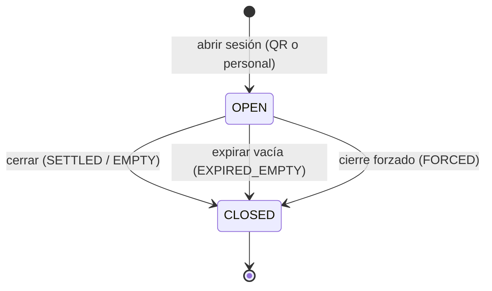
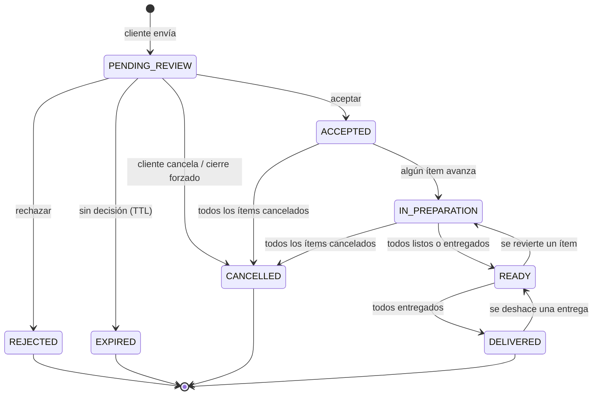
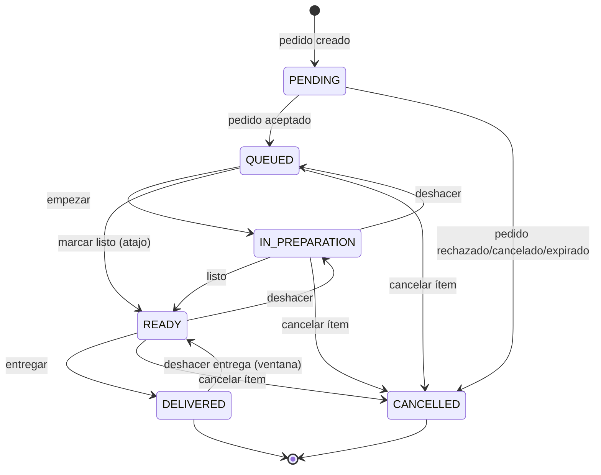
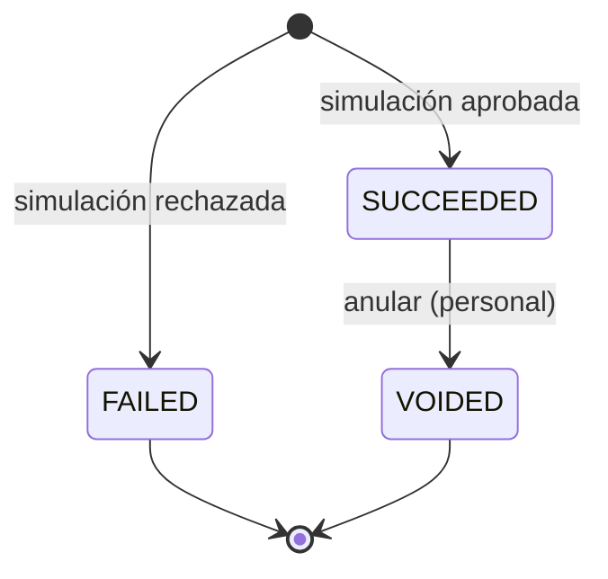
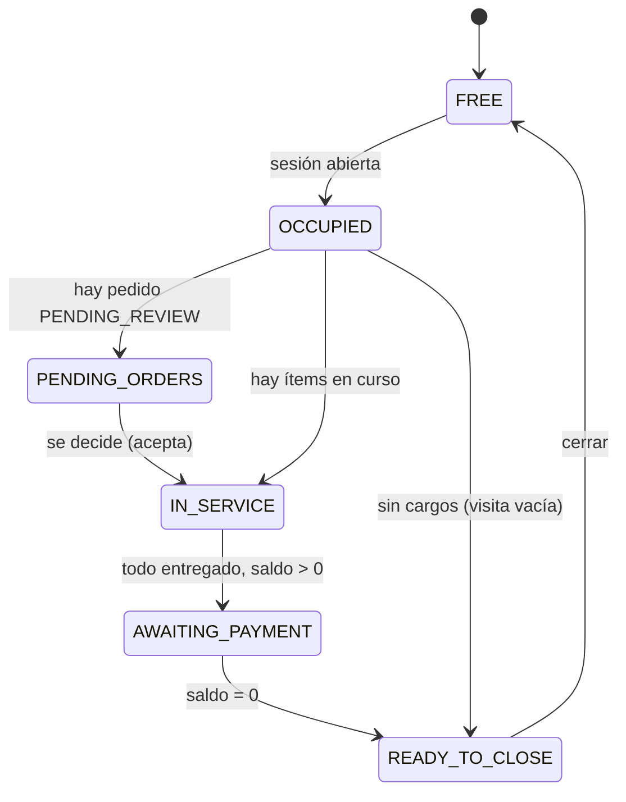
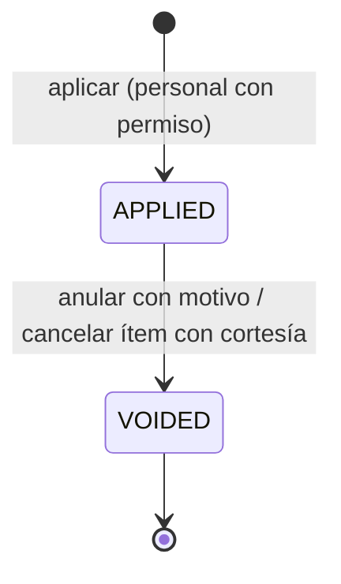
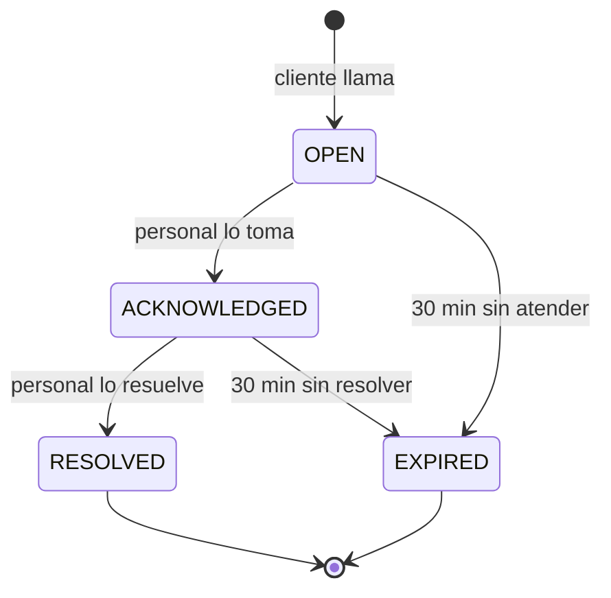

# Estados y transiciones

> Esta es la **fuente de verdad** de los estados. Backend, Web y Android usan **exactamente** estos nombres (enums idénticos en el contrato OpenAPI). Los nombres están en inglés porque viajan por la API; las etiquetas visibles al usuario están en `05-diseno/mapa-pantallas.md` §6.

## 1. Sesión de mesa (`TableSessionStatus`)

| De | Acción | A | Quién | Guardas (si falla → error) | Efectos | Auditoría | Evento |
|---|---|---|---|---|---|---|---|
| — | `open` | `OPEN` | Invitado (QR) / personal (`session.open_manual`) | Mesa activa, local abierto, sin sesión `OPEN` previa (`SESSION_ALREADY_OPEN`) | Por QR: crea participante `HOST` y `joinCode`. Por personal: crea la sesión y el `joinCode` **sin HOST**; el primer participante que se una pasa a ser `HOST` (RN-ACC-14, D-143) | `SESSION_OPENED` | `EV-session.updated` |
| `OPEN` | `close` → `SETTLED` | `CLOSED` | `session.close` | Sin pedidos `PENDING_REVIEW` (`SESSION_HAS_PENDING_ORDERS`); sin ítems `QUEUED/IN_PREPARATION/READY` (`SESSION_HAS_ACTIVE_ITEMS`); `balance == 0` (`SESSION_BALANCE_PENDING`); hay al menos un cargo | Invalida joinCode; tokens → solo lectura 24 h | `SESSION_CLOSED` | `EV-session.closed` |
| `OPEN` | `close` → `EMPTY` | `CLOSED` | `session.close` | Sin cargos y sin pendientes ni ítems activos | ídem | `SESSION_CLOSED` | ídem |
| `OPEN` | `expire` → `EXPIRED_EMPTY` | `CLOSED` | Sistema | Sin pedidos pendientes ni cargos y sin actividad 30 min | ídem | `SESSION_EXPIRED` | ídem |
| `OPEN` | `force_close` → `FORCED` | `CLOSED` | `session.force_close` + **motivo obligatorio** | — | Pedidos `PENDING_REVIEW` → `CANCELLED(SESSION_FORCED)`; ítems activos → `CANCELLED`; pagos y propinas ya registrados **se conservan**; si `balance < 0` se registra un **reembolso simulado automático** por el exceso (sin propina) en la misma transacción; si `balance > 0` queda como **saldo no cobrado** (RN-SES-06, D-159) | `SESSION_FORCE_CLOSED` (+ `REFUND_CREATED` si hubo reembolso automático) | ídem |

`CLOSED` es terminal. No hay reapertura en el MVP.

## 2. Pedido (`OrderStatus`)

**Importante:** hasta `ACCEPTED` las transiciones son *decisiones* sobre el pedido. Desde `ACCEPTED` el estado es **derivado** de sus ítems (§4). Los estados terminales de rechazo/cancelación/expiración **no cobran** nada.

| De | Acción | A | Quién | Guardas | Error | Auditoría | Evento |
|---|---|---|---|---|---|---|---|
| — | `create` | `PENDING_REVIEW` | Participante (`order.create`) o personal | Sesión `OPEN`, local abierto, producto válido/disponible, límites, total reconocido coincide, pendientes < 3 | `SESSION_CLOSED`, `RESTAURANT_CLOSED`, `PRODUCT_UNAVAILABLE`, `PRICE_CHANGED`, `ORDER_PENDING_LIMIT_REACHED`, `ORDER_*` | `ORDER_CREATED` | `EV-order.created` |
| `PENDING_REVIEW` | `accept` | `ACCEPTED` | `order.accept` | Estado actual `PENDING_REVIEW` (atómico); el TTL solo lo aplica el job | Si el estado ya es `EXPIRED`: `ORDER_EXPIRED`; otro estado decidido: `ORDER_ALREADY_DECIDED`; `ORDER_ALL_ITEMS_EXCLUDED` | `ORDER_ACCEPTED` | `EV-order.updated` |
| `PENDING_REVIEW` | `reject` | `REJECTED` | `order.reject` | Estado actual `PENDING_REVIEW` (atómico); el TTL solo lo aplica el job | Si el estado ya es `EXPIRED`: `ORDER_EXPIRED`; otro estado decidido: `ORDER_ALREADY_DECIDED` | `ORDER_REJECTED` | `EV-order.updated` |
| `PENDING_REVIEW` | `cancel` | `CANCELLED` | Autor/host (`order.cancel_own`) o personal | ídem | `ORDER_NOT_CANCELLABLE` | `ORDER_CANCELLED` | `EV-order.updated` |
| `PENDING_REVIEW` | `expire` | `EXPIRED` | Sistema | `elapsed >= orderPendingTtlMin`, sin decisión | Estado ya decidido: `ORDER_ALREADY_DECIDED`; invocación antes del límite: error de programación | `ORDER_EXPIRED` | `EV-order.updated` |

El job intenta la transición con una actualización condicional sobre `status = PENDING_REVIEW` y el límite temporal inclusivo. Si una aceptación/rechazo ganó la carrera, el job no modifica ese pedido; si el dominio recibe una transición inválida, informa el error correspondiente.

## 3. Ítem de pedido (`ItemStatus`)

| De | Acción | A | Permiso y alcance | Guardas | Error | Auditoría |
|---|---|---|---|---|---|---|
| `PENDING` | (aceptar pedido) | `QUEUED` | `order.accept` | — | — | con el pedido |
| `PENDING` | (aceptar con exclusión) | `CANCELLED` | `order.accept` | motivo obligatorio | `VALIDATION_FAILED` | `ITEM_EXCLUDED` |
| `QUEUED` | `start` | `IN_PREPARATION` | `item.prepare` + estación | Sesión `OPEN` | `ITEM_INVALID_TRANSITION`, `ITEM_STATION_FORBIDDEN` | `ITEM_STATUS_CHANGED` |
| `QUEUED`/`IN_PREPARATION` | `ready` | `READY` | ídem | ídem | ídem | ídem |
| `READY` | `deliver` | `DELIVERED` | `item.deliver` | ídem | `ITEM_INVALID_TRANSITION` | ídem |
| `QUEUED`/`IN_PREPARATION`/`READY` | `cancel` | `CANCELLED` | `order.cancel` (+ estación si es Cocina/Barra) | **motivo obligatorio**; no `DELIVERED` | `ITEM_NOT_CANCELLABLE` | `ITEM_CANCELLED` |
| `IN_PREPARATION` | `undo` | `QUEUED` | `item.undo` | — | `ITEM_INVALID_TRANSITION` | `ITEM_STATUS_REVERTED` |
| `READY` | `undo` | `IN_PREPARATION` | `item.undo` | — | ídem | ídem |
| `DELIVERED` | `undo` | `READY` | `item.undo` | **≤ 5 min** desde la entrega | `ITEM_UNDO_WINDOW_EXPIRED` | ídem |

Cada transición guarda timestamp (`queuedAt`, `startedAt`, `readyAt`, `deliveredAt`, `cancelledAt`) y actor, para métricas de tiempos de preparación.

**H-22 resuelta (2026-10-12):** si se deshace `READY` que vino directamente de `QUEUED`, el ítem vuelve a `IN_PREPARATION` con `startedAt = null`; no se inventa una hora de inicio que nunca ocurrió. Se conserva `queuedAt`.

`deliver-ready` entrega en una única operación todos los ítems que estén `READY` en ese pedido. Usa un solo instante de transición y aumenta `Order.version` una sola vez; si no hay ítems listos no modifica el agregado.

## 4. Derivación del estado del pedido desde sus ítems

Aplica cuando el pedido ya fue **aceptado**. Sea `S` el conjunto de estados de los ítems **no cancelados**:

| Condición | `OrderStatus` resultante |
|---|---|
| `S` vacío (todos cancelados) | `CANCELLED` |
| Todos en `DELIVERED` | `DELIVERED` |
| Todos en `{READY, DELIVERED}` (y no todos entregados) | `READY` |
| Alguno en `{IN_PREPARATION, READY, DELIVERED}` y no se cumple lo anterior | `IN_PREPARATION` |
| Todos en `QUEUED` | `ACCEPTED` |

La función `Order.recalculateStatus()` es **pura** (dominio), se ejecuta **en la misma transacción** que cambia un ítem y se verifica con pruebas de propiedades (cualquier secuencia válida de transiciones deja un estado derivado coherente).

> Esto resuelve el problema del plan: nadie puede marcar "terminado" un pedido completo mientras queden ítems pendientes en otra estación.

## 5. Pago (`PaymentStatus` y `PaymentKind`)

| Campo | Valores |
|---|---|
| `kind` | `PAYMENT`, `REFUND` |
| `method` | `SIMULATED_ONLINE` (participante), `CASH_COUNTER` (registrado por personal) |
| `status` | `SUCCEEDED`, `FAILED`, `VOIDED` |

| Acción | Quién | Guardas | Errores | Auditoría |
|---|---|---|---|---|
| Crear `PAYMENT` | Participante (`payment.create`) / personal (`payment.register_cash`) | Sesión `OPEN`; con `amountMinor > 0`: `min(minPaymentMinor, balance) ≤ amount ≤ balance` y `balance > 0` (D-158); con `amountMinor = 0`, solo propina (§8.1, D-146); idempotencia | `SESSION_CLOSED`, `PAYMENT_AMOUNT_INVALID`, `PAYMENT_EXCEEDS_BALANCE`, `PAYMENT_NOTHING_TO_PAY`, `PAYMENT_DECLINED` | `PAYMENT_CREATED` / `PAYMENT_FAILED` |
| Anular | `payment.void` | `SUCCEEDED`, sesión `OPEN`, motivo | `PAYMENT_NOT_VOIDABLE` | `PAYMENT_VOIDED` |
| `REFUND` | `payment.refund` | Sesión `OPEN`; `amount ≤ pagado neto`; motivo (el reembolso automático del cierre forzado, D-159, lo crea el sistema mientras cierra la sesión) | `REFUND_EXCEEDS_PAID` | `REFUND_CREATED` |

## 6. Estado visible de la mesa (derivado para el tablero del personal)

Prioridad si se cumplen varias: `PENDING_ORDERS` > `IN_SERVICE` > `AWAITING_PAYMENT` > `READY_TO_CLOSE` > `OCCUPIED` > `FREE`. Se calcula en servidor y se devuelve ya resuelto en `GET /staff/tables`.

## 7. Matriz de transiciones inválidas (todas deben probarse)

Cualquier combinación `(estado actual, acción)` que **no** aparezca en las tablas de arriba debe devolver `409` con el código correspondiente (`ORDER_ALREADY_DECIDED`, `ITEM_INVALID_TRANSITION`, `SESSION_CLOSED`, etc.) y **no** modificar datos. QA genera estos casos de forma parametrizada a partir de las tablas.

## 8. Añadidos en v0.2

### 8.1 Pago con propina
`PaymentKind`/`PaymentStatus` no cambian. Un pago `PAYMENT` puede llevar `tipMinor ≥ 0`; si `amountMinor = 0`, `tipMinor > 0` (pago solo propina). Anular el pago anula la propina (`VOIDED`). Un pago solo propina no se rechaza por saldo 0 (D-146); el mínimo de pago aplica solo al monto principal (D-158).

### 8.2 Ajuste de cuenta (`AdjustmentStatus`)

| Acción | Quién | Guardas | Errores | Auditoría |
|---|---|---|---|---|
| Aplicar | `adjustment.apply` (límite) / `adjustment.apply_any` | Sesión `OPEN`; motivo; `monto ≤ balance`; dentro del límite del rol; ítem aceptado, no cancelado y sin cortesía previa si es cortesía (RN-ADJ-04) | `ADJUSTMENT_INVALID`, `ADJUSTMENT_EXCEEDS_BALANCE`, `ADJUSTMENT_LIMIT_EXCEEDED`, `ADJUSTMENT_ITEM_INVALID`, `SESSION_CLOSED` | `ADJUSTMENT_APPLIED` |
| Anular | `adjustment.void` | `APPLIED`; sesión `OPEN`; motivo; Mozo: propio y ≤ 10 min | `ADJUSTMENT_NOT_VOIDABLE`, `FORBIDDEN` | `ADJUSTMENT_VOIDED` |

### 8.3 Llamado al mozo (`WaiterCallStatus`)

| Acción | Quién | Errores | Evento |
|---|---|---|---|
| `create` | Participante | `WAITER_CALL_ALREADY_ACTIVE`, `WAITER_CALL_COOLDOWN`, `SESSION_CLOSED` | `waiter.called` |
| `acknowledge` / `resolve` | `waiter_call.handle` | `WAITER_CALL_NOT_FOUND`, `STATE_CONFLICT` | `waiter.updated` |

La insignia "llamando" del tablero no cambia el `displayStatus` de la mesa: es un indicador adicional.
