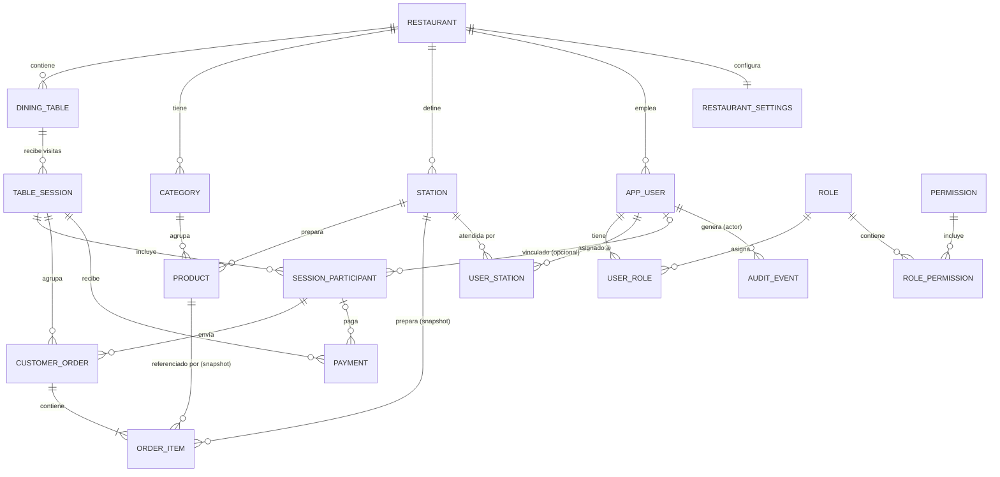

# Modelo de dominio

> Este documento describe **qué existe en el negocio**. La forma física (tablas, índices) está en `modelo-datos.md`.

## 1. Distinciones que nunca se mezclan

| Concepto | Es… | No es… |
|---|---|---|
| **Mesa** | El lugar físico, con su QR | Una visita |
| **Sesión** | Una visita concreta a una mesa; agrupa pedidos, pagos y participantes | Un pedido ni una cuenta persistente de la mesa |
| **Participante** | Persona autorizada en **esa** sesión | Un usuario registrado (puede o no estar vinculado) |
| **Pedido** | Una solicitud enviada en un momento | La cuenta |
| **Ítem** | Una línea con producto, cantidad, precio histórico, estación y estado propios | El producto del catálogo |
| **Cuenta** | Saldo derivado: cargos − pagos | Una entidad guardada |

> Una mesa tiene muchas sesiones históricas, **nunca simultáneas abiertas**. Una visita nueva **no hereda** pedidos ni saldo.

## 2. Diagrama entidad-relación conceptual

## 3. Entidades y responsabilidades

| Entidad | Módulo | Responsabilidad | Atributos clave |
|---|---|---|---|
| `Restaurant` | identity | Identidad del local | name, timezone, currency |
| `RestaurantSettings` | identity | Parámetros operativos | opening hours, business-day cutoff, límites, TTLs, `requireStaffToOpenSession` |
| `AppUser` | identity | Cuenta registrada (personal, dueño, cliente) | email, passwordHash, status, tokenVersion |
| `Role` / `Permission` | identity | Paquete y unidad de autorización | code, isSystem |
| `Category` | catalog | Agrupa productos | name, sortOrder, active |
| `Product` | catalog | Producto vendible | name, description, priceMinor, available, active, stationId, allergens, imageUrl, imageAlt |
| `Station` | preparation | Sector de preparación | code (`BAR`/`KITCHEN`), name |
| `DiningTable` | floor | Mesa física | label, tableCode, qrVersion, active, capacity |
| `TableSession` | floor | Visita | status, openedAt, closedAt, closeReason, joinCode |
| `SessionParticipant` | floor | Persona autorizada | displayName, role (`HOST`/`MEMBER`), tokenHash, revokedAt, userId? |
| `Order` | orders | Pedido | displayCode, status, note, createdByParticipantId, decidedBy, decidedAt, rejectionReason |
| `OrderItem` | orders | Línea con **snapshot** | productId, productName, unitPriceMinor, quantity, note, stationId, status, cancelReason |
| `Payment` | billing | Pago/reembolso/anulación | kind, method, status, amountMinor, payerParticipantId?, idempotencyKey |
| `AuditEvent` | audit | Registro inmutable | actor, action, target, reason, traceId |
| `DomainEvent` (`event_log`) | notifications | Fuente de eventos de tiempo real | type, aggregateId, version |
| `IdempotencyRecord` | shared | Idempotencia | key, scope, requestHash, response |
| `Feedback` | feedback (F9) | Encuesta posterior | rating, comment |

## 4. Agregados e invariantes

| Agregado (raíz) | Contiene | Invariantes que el dominio garantiza |
|---|---|---|
| **TableSession** | Participantes | Una sola `OPEN` por mesa; `CLOSED` es terminal; join code solo válido mientras `OPEN`; ≤ máx. participantes; un solo `HOST` |
| **Order** | Items | Total calculado = Σ ítems; solo `PENDING_REVIEW` puede decidirse; estado derivado **siempre** coherente con ítems (se recalcula tras cada cambio); inmutable en cantidades/precios tras creación |
| **Payment** | — | `amountMinor > 0`; `SUCCEEDED` no se edita (solo se anula con nuevo registro de estado); reembolso ≤ neto pagado |
| **Product** | — | Precio ≥ 0 (> 0 para vender); pertenece a una categoría y una estación |
| **AppUser** | Roles, estaciones | Email único; ≥ 1 `OWNER` activo en el restaurante |

La **cuenta (`Bill`)** no es un agregado: es una **consulta derivada** de `Order/Item` y `Payment` calculada dentro de la transacción cuando hace falta (ver `reglas-negocio.md`, RN-BIL).

## 5. Objetos de valor
| VO | Regla |
|---|---|
| `Money` | `amountMinor: Long`, nunca negativo salvo el saldo; moneda única |
| `DisplayCode` | `#NNN`, único por (restaurante, día de negocio) |
| `JoinCode` | 6 caracteres de `ABCDEFGHJKMNPQRSTUVWXYZ23456789` (sin 0, O, 1, I, L) |
| `TableCode` | Base62, ≥ 22 caracteres (128 bits) |
| `PermissionCode` | `modulo.accion` |

## 6. Valores derivados
| Derivado | Fórmula |
|---|---|
| `charges` | Σ `lineTotalMinor` de ítems **no cancelados** de pedidos en `ACCEPTED/IN_PREPARATION/READY/DELIVERED` |
| `paid` | Σ pagos `PAYMENT` `SUCCEEDED` − Σ `REFUND` `SUCCEEDED` (anulados excluidos) |
| `adjustments` | Σ ajustes `APPLIED` (descuentos, cortesías, ajustes manuales) |
| `balance` | `charges − adjustments − paid` (puede ser negativo → "a favor", se resuelve con reembolso antes de cerrar) |
| `tips` | Σ `tipMinor` de pagos `SUCCEEDED` no anulados. **No** entra en el saldo |
| `Order.status` (post-aceptación) | Función de estados de ítems (ver `estados-y-transiciones.md` §4) |
| `Table.displayStatus` | `FREE`, `OCCUPIED`, `PENDING_ORDERS`, `IN_SERVICE`, `AWAITING_PAYMENT`, `READY_TO_CLOSE` (ver §5 de estados) |

## 7. Entidades añadidas en v0.2

| Entidad | Módulo | Responsabilidad | Atributos clave |
|---|---|---|---|
| `OptionGroup` | catalog | Grupo de opciones reutilizable ("Tamaño", "Leche", "Extras") | name, selectionType, required, min/maxSelections, sortOrder, active |
| `Option` | catalog | Opción elegible con delta de precio | name, priceDeltaMinor, available, active, isDefault |
| `ProductOptionGroup` | catalog | Asignación producto ↔ grupo, con orden | productId, groupId, sortOrder |
| `*Translation` | catalog | Traducciones de categoría, producto, grupo y opción | entityId, locale, name, description |
| `BillAdjustment` | billing | Descuento / cortesía / ajuste manual | kind, percentBp?, orderItemId?, amountMinor, reasonCode, status (`APPLIED`/`VOIDED`) |
| `WaiterCall` | floor | Aviso del cliente al personal | reason, status (`OPEN`/`ACKNOWLEDGED`/`RESOLVED`/`EXPIRED`) |
| `Payment.tipMinor` | billing | Propina libre adjunta al pago | tipMinor ≥ 0 |

Invariantes nuevas: un grupo `required` necesita ≥ 1 opción disponible para que el producto sea pedible; `Σ ajustes APPLIED ≤ charges`; un pago puede tener `amountMinor = 0` solo si `tipMinor > 0`; un llamado activo por (sesión, motivo).
