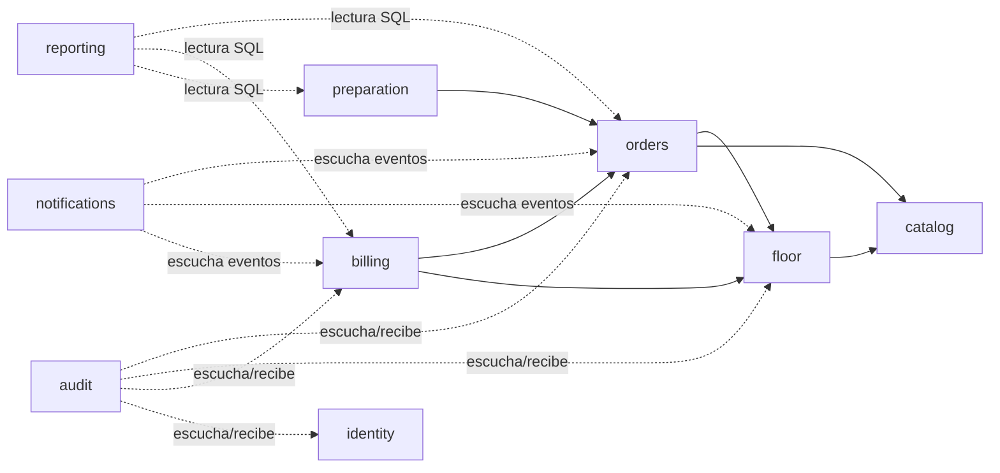
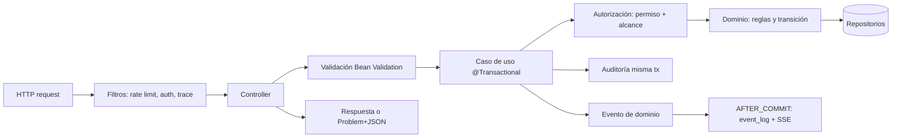
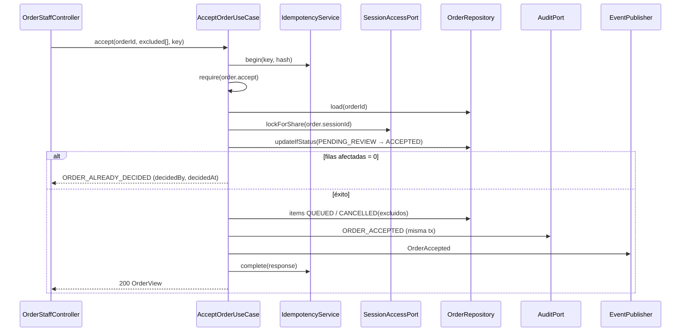

# Arquitectura del backend

## 1. Estructura de módulos y capas

Monolito modular (ADR-0002). Paquete raíz: `com.somphie`. Cada módulo tiene las mismas 4 capas:

```
backend/src/main/kotlin/com/somphie/
├── shared/                  kernel: Money, Ids, Clock, errores (Problem), idempotencia, seguridad base
├── catalog/    { api, application, domain, infrastructure }
├── identity/   { ... }
├── floor/      { ... }      mesas, sesiones, participantes
├── orders/     { ... }      pedido + ítems + TODAS sus transiciones
├── preparation/{ ... }      estaciones, colas, endpoints por estación (delegan en orders)
├── billing/    { ... }      cuenta derivada, pagos, reembolsos, comprobante
├── notifications/ { ... }   event_log, SSE, email, push (puertos)
├── reporting/  { ... }      consultas de solo lectura
└── audit/      { ... }
```

| Capa | Contiene | Puede depender de | **No** puede depender de |
|---|---|---|---|
| `domain` | Entidades, VO, reglas, máquinas de estado, eventos de dominio | Solo Kotlin estándar y `shared.domain` | Spring, JPA, HTTP, otros módulos |
| `application` | Casos de uso (`CreateOrder`, `AcceptOrder`, `RegisterPayment`…), **puertos** (interfaces), DTO de entrada/salida, `@Transactional` | `domain` propio, puertos de otros módulos | `infrastructure`, `api` |
| `infrastructure` | Repositorios JPA, adaptadores de email/PDF/SSE, implementaciones de puertos | `application`, `domain` | `api` |
| `api` | Controladores REST, DTO HTTP, mapeo a casos de uso, validación Bean Validation | `application` | `domain` directo, `infrastructure` |

> Nota pragmática (D-019): **no** crear interfaz+implementación para todo. Solo hay puerto cuando (a) aísla un detalle externo (email, PDF, pagos, reloj), (b) cruza módulos, o (c) permite una prueba que de otro modo sería imposible.

## 2. Grafo de dependencias entre módulos



Reglas:
- Flecha sólida = **dependencia de puerto** (la capa `application` del módulo origen usa una interfaz publicada por el destino).
- Flecha punteada = **evento** o lectura SQL propia; no hay referencia al código del otro módulo.
- **Sin ciclos.** `floor` no conoce `orders`: `orders` pregunta a `floor` por la sesión.
- Ningún módulo accede a **repositorios ni entidades JPA** de otro.
- `ArchUnit` verifica: (1) reglas de capas, (2) ausencia de ciclos, (3) que `domain` no importe Spring/JPA, (4) que nadie importe `*.infrastructure.*` de otro módulo.

## 3. Puertos entre módulos

| Puerto (publicado por) | Lo usa | Para |
|---|---|---|
| `SessionAccessPort` (floor) | orders, billing | Resolver sesión, comprobar `OPEN`, participante, bloquear (`lockForShare` / `lockForUpdate`) |
| `ProductQueryPort` (catalog) | orders | Datos vigentes de productos (precio, disponibilidad, estación) |
| `OrderCommandPort` (orders) | preparation | Transiciones de ítem (`start`, `ready`, `deliver`, `cancel`, `undo`) |
| `OrderChargesPort` (orders) | billing | Importes facturables y datos de ítems para cortesías; el dominio de pedidos aplica sus estados antes de entregar los cargos (única definición, ver `modelo-datos.md` §4) |
| `OrderActivityPort` (orders) | floor (cierre) | ¿Hay pendientes/ítems activos? |
| `CurrentActor` (shared) | todos | Principal autenticado y permisos |
| `AuditPort` (audit) | todos | Registrar evento en la misma transacción |
| `EventPublisher` (shared) | todos | Publicar evento de dominio |
| `EmailSender`, `PdfRenderer`, `PaymentProvider`, `Clock` (shared/infra) | varios | Aislar detalles externos |

> **Ciclo potencial `floor ↔ orders` en el cierre:** el cierre vive en `floor` y consulta a `orders` mediante `OrderActivityPort`; `billing` aporta el saldo mediante `BillingSummaryPort`. Para evitar el ciclo, el caso de uso `CloseSession` se ubica en un **orquestador** (`application` de `floor`) que recibe esos puertos por inyección; `orders` jamás depende de `floor.application` salvo vía `SessionAccessPort`. Si aparece un ciclo real, se resuelve con eventos o moviendo el caso de uso al módulo que posee la mayor parte de la regla.

## 4. Flujo típico de una operación



Orden dentro del caso de uso: **idempotencia → autorización → carga con lock → validación de estado y reglas → cambio de dominio → persistir → auditoría → evento**.

## 5. Transversales

| Tema | Decisión |
|---|---|
| Transacciones | Un caso de uso = una transacción; nunca llamadas HTTP/email dentro de la transacción |
| Errores | Excepciones de dominio con `code` → manejador global → Problem+JSON; nunca se expone traza |
| Validación | Bean Validation en `api`; reglas de negocio en dominio/aplicación |
| Autorización | `@PreAuthorize`-like en `application` (no solo en el controlador) y verificación de alcance en el caso de uso |
| Logs | JSON estructurado; `traceId` en cada línea y en la respuesta; **sin** tokens ni contraseñas ni datos de pago |
| Config | `application.yml` + variables de entorno; perfiles `dev`, `test`, `demo`, `prod` |
| Jobs | `@Scheduled` para expiraciones; seguros con actualizaciones condicionales (varias instancias no duplican efectos) |
| Salud | Spring Actuator: `/actuator/health` (liveness/readiness), métricas básicas; endpoints sensibles protegidos |
| PDF | Puerto `PdfRenderer`; adaptador HTML→PDF (a decidir en ADR de Fase 7) |
| Pagos | Puerto `PaymentProvider`; adaptador `SimulatedPaymentProvider` |
| Rate limit | Filtro por IP/token con bucket en memoria (suficiente en una instancia); evaluar Bucket4j |
| Reloj | Siempre `Clock` inyectado (testeable); jamás `Instant.now()` directo en dominio |

## 5.1 Testabilidad arquitectónica
- **Dominio:** pruebas unitarias sin Spring (rápidas, miles).
- **Aplicación:** casos de uso con repositorios en memoria *o* con Testcontainers según el riesgo.
- **Infraestructura:** Testcontainers (PostgreSQL real): restricciones, locks, índices únicos.
- **API:** `@WebMvcTest` + contrato OpenAPI.
- **Arquitectura:** ArchUnit.

## 6. Ejemplo: `AcceptOrder`



## 7. Estructura de pruebas
```
backend/src/test/kotlin/com/somphie/
├── <modulo>/domain/        unitarias (sin Spring)
├── <modulo>/application/   casos de uso
├── <modulo>/infrastructure/ integración con Testcontainers
├── <modulo>/api/           WebMvc + contrato
├── architecture/           ArchUnit
└── e2e/                    flujo completo con la app arrancada
```
