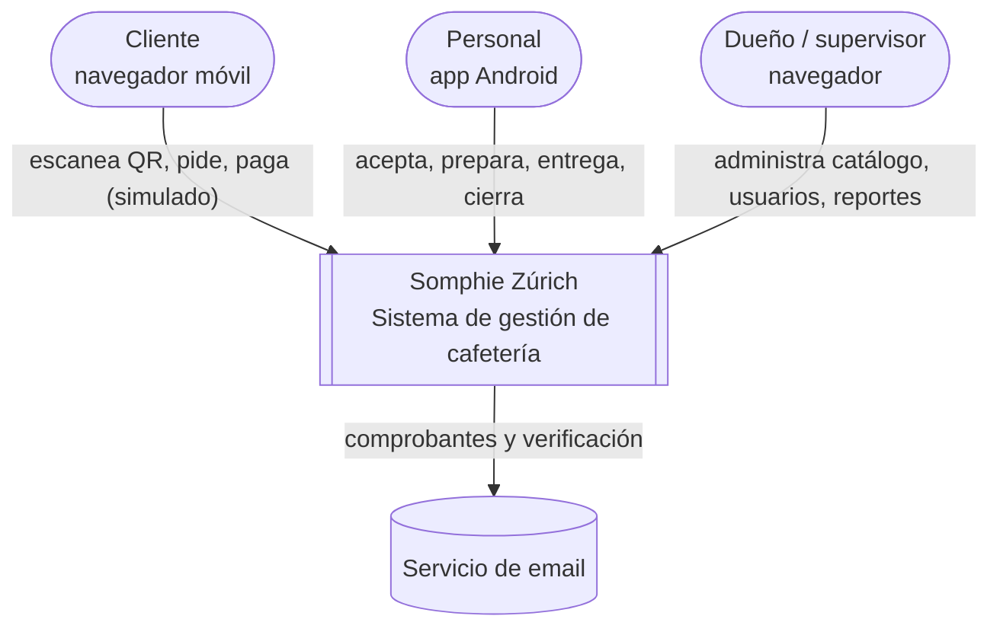
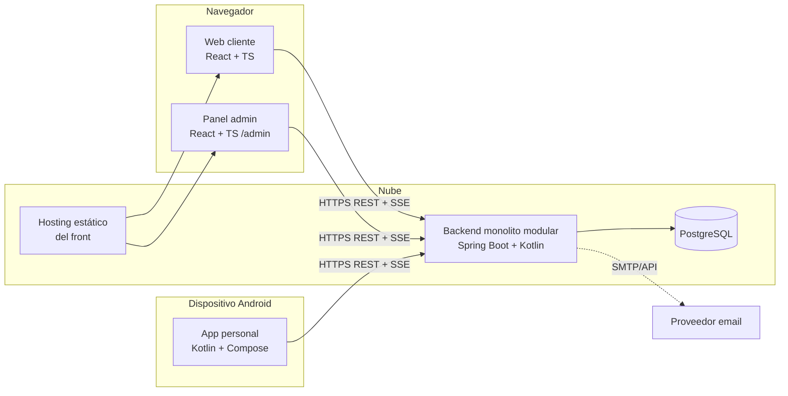
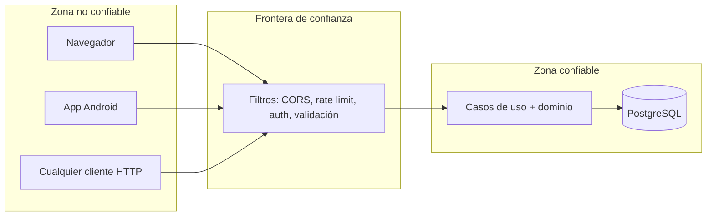
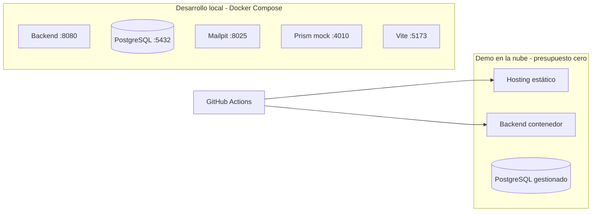

# Arquitectura: contexto y contenedores

## 1. Contexto (C4 nivel 1)

## 2. Contenedores (C4 nivel 2)

## 3. Responsabilidades por contenedor

| Contenedor | Decide | Muestra | Nunca |
|---|---|---|---|
| **Backend** | Reglas, permisos, precios, estados, saldos, idempotencia, auditoría | — | Confiar en datos de cliente |
| **Web cliente** | Nada de negocio | Menú, carrito, estado, cuenta, pago | Calcular precio final como verdad; guardar datos de tarjeta |
| **Panel admin** | Nada de negocio | Tablas, formularios, reportes | Aplicar permisos "solo visuales" |
| **App Android** | Nada de negocio | Colas, tablero, acciones según permisos | Marcar estados localmente sin confirmación del servidor |
| **PostgreSQL** | Consistencia final (constraints, índices únicos) | — | Contener reglas que no estén también en el dominio |

## 4. Límites de confianza

Todo lo que entra por la frontera se **valida de nuevo**: formato, permisos, alcance, estado y reglas.

## 5. Vista de despliegue (objetivo, 🔴 proveedor pendiente Q-05)

## 6. Stack por capa

| Capa | Tecnología | Motivo |
|---|---|---|
| App personal | Kotlin + Jetpack Compose | Experiencia previa, Android moderno |
| Web cliente y admin | React + TypeScript + Vite | Tipado, un solo proyecto |
| Backend | Spring Boot + Kotlin | API estructurada, validación, seguridad |
| Base | PostgreSQL | Transacciones, restricciones, índices parciales |
| Persistencia | Spring Data JPA (+ consultas SQL/JPQL donde convenga) | Menos trabajo repetitivo |
| Migraciones | Flyway | Esquema versionado y reproducible |
| Seguridad | Spring Security | Autenticación y autorización |
| Validación | Bean Validation | Entradas validadas antes de reglas |
| Contrato | OpenAPI 3.1 | Fuente compartida |
| Tiempo real | SSE | ADR-0006 |
| Pruebas | JUnit, Testcontainers, Vitest/RTL/MSW, Playwright, Compose UI Test | Ver `06-pruebas` |

> Las versiones concretas se fijan al iniciar la Fase 2 (verificar versiones estables vigentes).
