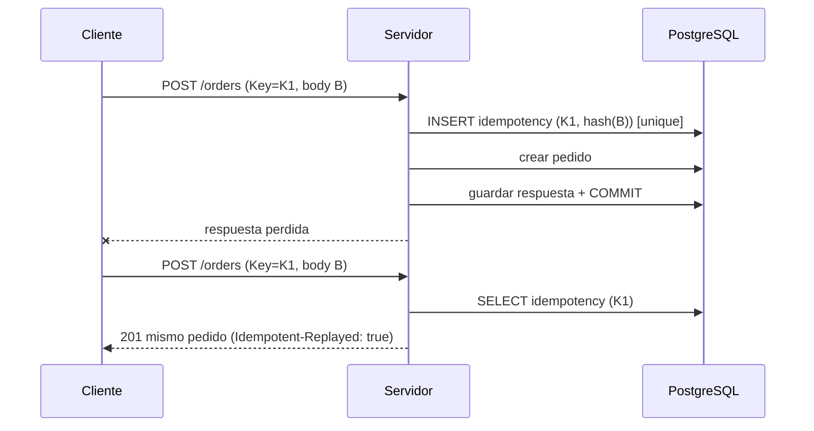

# Idempotencia y concurrencia

> Principio: la interfaz **no** evita carreras. Se resuelven en el servidor y en la base de datos.

## 1. Idempotencia

### 1.1 Qué operaciones la exigen
| Operación | `Idempotency-Key` | Alcance de la clave |
|---|---|---|
| Abrir sesión (`POST …/sessions`) | Obligatoria | IP+mesa (pre-autenticación) |
| Unirse (`POST …/join`) | Recomendada | IP+mesa |
| Crear pedido | **Obligatoria** | participante |
| Aceptar / rechazar / cancelar ítem / transiciones de ítem | Obligatoria | usuario |
| Crear pago / reembolso / anulación | **Obligatoria** | actor + sesión |
| Cerrar sesión | No (idempotente por naturaleza: cerrada → `200`) | — |
| `GET`, `PUT`/`PATCH` absolutos de admin | No | — |

### 1.2 Protocolo
1. El cliente genera un **UUID v4 por intento lógico** (no por cada reintento HTTP) y lo reutiliza en los reintentos.
2. Servidor, al recibir: busca `(scope, key)`.
   - **No existe** → inserta registro `IN_PROGRESS` con `request_hash` (en la misma transacción que la operación) y ejecuta.
   - **Existe y `COMPLETED`**, hash igual → devuelve respuesta guardada + `Idempotent-Replayed: true`.
   - **Existe y hash distinto** → `422 IDEMPOTENCY_KEY_REUSED`.
   - **Existe y `IN_PROGRESS`** → `409 IDEMPOTENCY_IN_PROGRESS` (el cliente reintenta en 1–2 s).
3. Al terminar la operación, se guarda `response_status` y `response_body` **dentro de la misma transacción** → si la transacción falla, no queda registro y el reintento ejecuta de cero.
4. TTL: 24 h.



### 1.3 Reglas para clientes
- Mostrar el botón "procesando" y **bloquear** repetición local.
- Si cambian los datos (ej. `PRICE_CHANGED` → nuevo total), es **otro intento lógico**: clave nueva.
- Nunca reutilizar una clave para operaciones distintas.

## 2. Concurrencia

### 2.1 Herramientas
| Herramienta | Uso |
|---|---|
| **Actualización condicional** `UPDATE … WHERE id=? AND status=?` | Transiciones de pedido/ítem; "gana el primero" sin bloqueos largos. Se comprueba `rowsAffected` |
| **Bloqueo de fila de sesión** | Coordinar operaciones que afectan al saldo/cierre |
| **Optimistic locking (`@Version`)** | Edición concurrente de catálogo/usuarios/ajustes |
| **Restricciones únicas / parciales** | Última defensa: una sesión abierta por mesa, idempotencia, `display_code` |
| **Contador atómico** | `order_counter` con `INSERT … ON CONFLICT DO UPDATE … RETURNING` |

### 2.2 Protocolo de bloqueo de sesión

| Operación | Lock sobre `table_session` | Por qué |
|---|---|---|
| Crear pedido, aceptar, cancelar ítem, cambiar ítems que afectan cargos | `FOR SHARE` | Muchas pueden coexistir, pero ninguna mientras alguien decide sobre el saldo |
| Pago, anulación, reembolso, **cierre** | `FOR UPDATE` | Exclusivo: el saldo calculado no puede cambiar durante la operación |
| Transiciones de ítem que **no** cambian cargos (`start`, `ready`, `deliver`) | Ninguno (solo condicional por estado) | Alta frecuencia, sin impacto en saldo |
| Expiraciones por job | Condicional por estado | Idempotentes |

**Orden de bloqueo obligatorio** (evita deadlocks): `table_session` → `customer_order` → `order_item` → `payment`. Nunca al revés.

```mermaid
sequenceDiagram
  participant P1 as Pagador 1
  participant P2 as Pagador 2
  participant DB as PostgreSQL
  P1->>DB: BEGIN; SELECT session FOR UPDATE
  P2->>DB: BEGIN; SELECT session FOR UPDATE (espera)
  P1->>DB: saldo = 1000; pago 1000; COMMIT
  DB-->>P2: lock liberado
  P2->>DB: saldo = 0 → PAYMENT_NOTHING_TO_PAY / EXCEEDS_BALANCE
```

### 2.3 Aislamiento
- Nivel por defecto `READ COMMITTED`, suficiente porque las decisiones de saldo se toman **con lock**.
- No se usa `SERIALIZABLE` en el MVP (más complejo, reintentos obligatorios).

### 2.4 Catálogo de escenarios → mecanismo
Ver `casos-limite.md` §2 (CL-020 a CL-032). Cada uno tiene una prueba de concurrencia.

## 3. Cómo probar concurrencia (receta para QA/Backend)
1. Testcontainers + PostgreSQL real.
2. Lanzar N hilos/corrutinas con `CountDownLatch`/barrera para soltarlos a la vez.
3. Afirmar **invariantes**, no orden: "exactamente 1 aceptación", "Σ pagos ≤ cargos", "0 duplicados".
4. Repetir 50–200 iteraciones para detectar intermitencias.
5. Un test de carga ligero (k6 o similar) para el doble envío masivo.

## 4. Anti-patrones prohibidos
- Leer saldo, decidir en memoria y escribir **sin lock**.
- Validar solo en la UI.
- Usar `synchronized`/locks en memoria como solución (no sirve con más de una instancia).
- Capturar la violación de restricción y silenciarla sin respuesta clara.
- Llamadas externas (email/HTTP) dentro de una transacción con locks.
