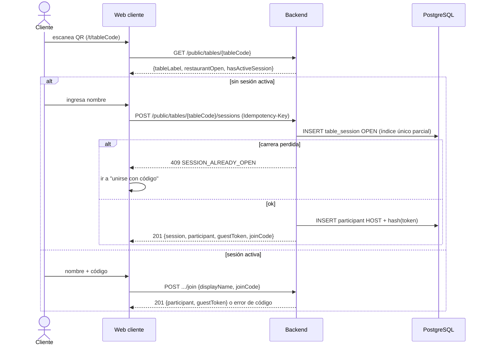
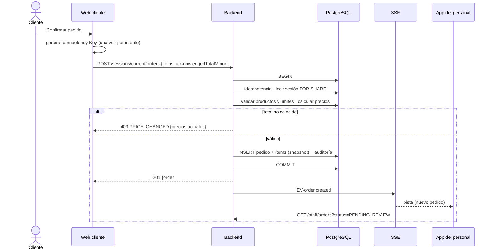
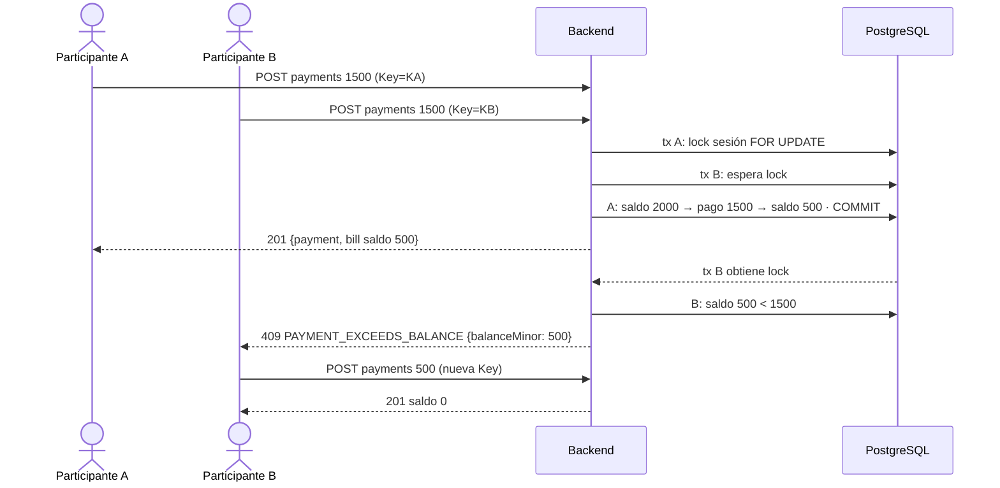
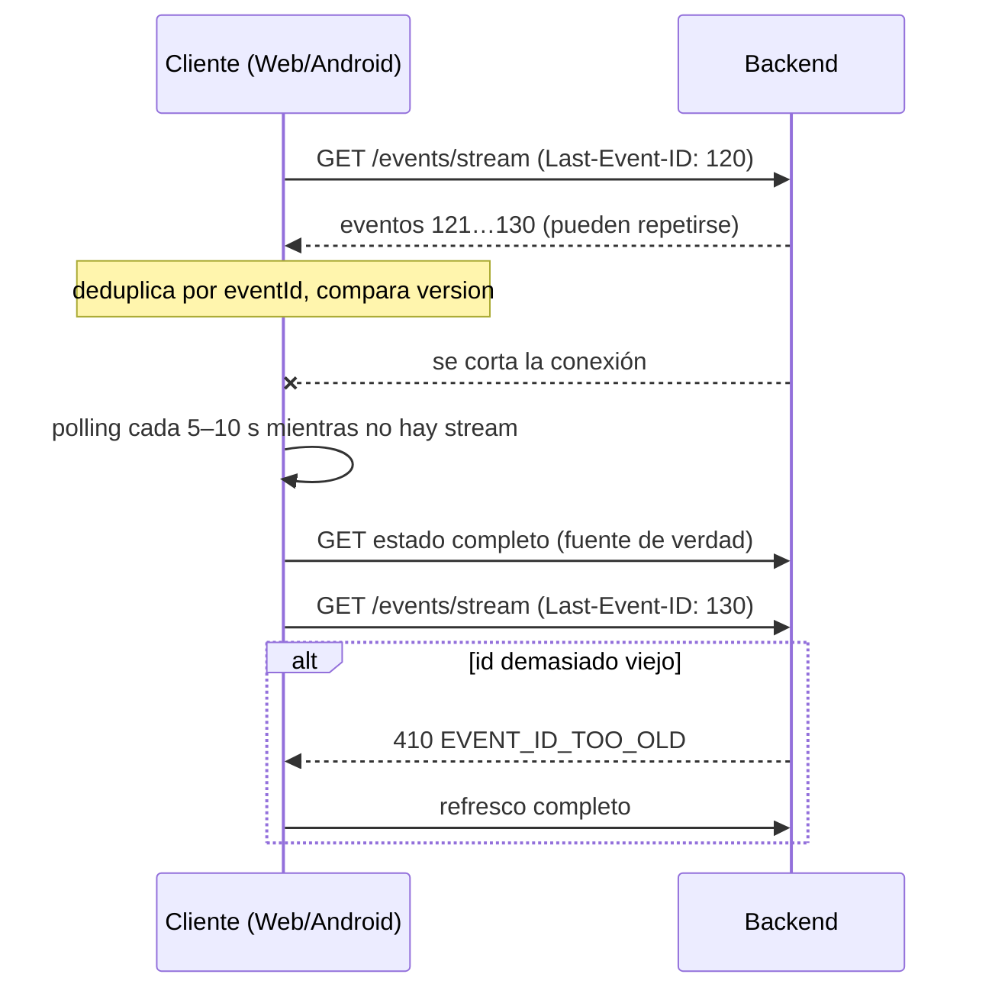

# Diagramas de secuencia de los flujos principales

## S1 — QR → abrir sesión



## S2 — Enviar pedido



## S3 — Aceptar y preparar

```mermaid
sequenceDiagram
  actor M as Mozo
  actor B as Barra
  actor K as Cocina
  participant AND as App Android
  participant API as Backend
  participant W as Web cliente
  M->>AND: Aceptar pedido #042
  AND->>API: POST /staff/orders/{id}/accept
  API-->>AND: 200 ACCEPTED
  API-->>W: EV-order.updated (cliente ve "Aceptado")
  B->>API: item bebida: start → ready
  K->>API: item comida: start
  API->>API: recalcula Order.status = IN_PREPARATION
  K->>API: item comida: ready
  API->>API: todos listos → Order.status = READY
  M->>API: deliver (ítems)
  API->>API: todos entregados → DELIVERED
  API-->>W: EV-order.updated
```

## S4 — Pago simultáneo (cuenta compartida)



## S5 — Cierre de sesión

```mermaid
sequenceDiagram
  actor M as Mozo
  participant AND as App Android
  participant API as Backend
  participant DB as PostgreSQL
  participant W as Web cliente
  M->>AND: Cerrar sesión
  AND->>API: POST /staff/sessions/{id}/close
  API->>DB: lock sesión FOR UPDATE
  API->>DB: pendientes? ítems activos? saldo?
  alt hay impedimentos
    API-->>AND: 409 SESSION_HAS_* / SESSION_BALANCE_PENDING (detalle)
  else todo en orden
    API->>DB: status=CLOSED, closeReason=SETTLED, invalida joinCode, auditoría
    API-->>AND: 200 CLOSED
    API-->>W: EV-session.closed
    W->>W: muestra "Visita finalizada" + comprobante
  end
```

## S6 — Reconexión y eventos duplicados



## S7 — Autenticación del personal (refresh rotativo)

```mermaid
sequenceDiagram
  participant AND as App Android
  participant API as Backend
  AND->>API: POST /auth/login
  API-->>AND: access (15 min) + refresh (rotativo)
  AND->>API: request con access vencido
  API-->>AND: 401 TOKEN_EXPIRED
  AND->>API: POST /auth/refresh (refresh R1)
  API-->>AND: access nuevo + refresh R2 (R1 invalidado)
  Note over AND,API: si R1 se reutiliza → 401 REFRESH_TOKEN_REUSED y se revoca la familia
```
