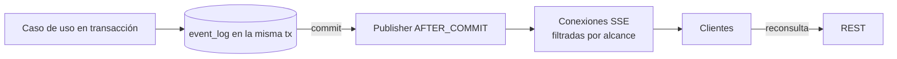

# Tiempo real (Fase 6)

> Decisión base: **SSE** con eventos "pista" (ADR-0006), aprobada por D-160. Mientras WP-BE-60 no esté implementada, los consumidores siguen con polling.
>
> Estado al 2026-10-14: WP-ARQ-60 está aprobada; `event_log`, productores transaccionales y endpoint SSE todavía están pendientes de implementación y validación. El flujo siguiente es diseño objetivo, no infraestructura desplegada.

Se usa PostgreSQL como log durable/outbox transaccional y fuente de replay SSE; un aviso post-commit en memoria solo optimiza el despertar de lectores. El cursor se asigna con contador bloqueado por restaurante hasta commit para ordenar los eventos visibles. Ver costos, pruebas y límites en [ADR-0006](../00-gobierno/adr/ADR-0006-tiempo-real-sse.md).

## 1. Estrategia por fases
| Fase | Mecanismo |
|---|---|
| 3–5 | REST + polling (web cliente: 5–10 s con ETag/`If-None-Match`; Android: 5 s en primer plano) |
| 6 | SSE con `event_log`, `Last-Event-ID`, heartbeat. Polling pasa a **fallback** |
| posterior | Push FCM para app cerrada (puerto `PushSender`) |

## 2. Principios
1. El evento **avisa**, la API **informa**: ante un evento el cliente reconsulta el recurso.
2. El backend sigue siendo la fuente de verdad (RN-RT-01).
3. Tolerar eventos tardíos o duplicados (deduplicar por `eventId`; usar `version`).
4. Tras reconectar, reconsultar estado y reanudar con `Last-Event-ID`.
5. Un fallo al emitir **no** revierte la operación (RN-RT-06).

## 3. Canal y alcance
| Stream | URL | Quién | Qué recibe |
|---|---|---|---|
| Sesión | `GET /events/stream?scope=session` (token de invitado) | Participantes | Eventos de **su** sesión |
| Staff | `GET /events/stream?scope=staff` (JWT) | Personal | Eventos del restaurante filtrados por permiso/estación |
| Admin | `GET /events/stream?scope=staff` | Dueño | Igual que staff (+ catálogo) |

- Autenticación por `Authorization: Bearer`. Como `EventSource` nativo no permite headers, la web usa `fetch` + lector de stream (o polyfill). Android usa OkHttp SSE.
- Heartbeat (comentario `:`) cada 25 s. Cliente reconecta con **backoff exponencial + jitter** (1s→30s).

## 4. Flujo de emisión

El evento se inserta en `event_log` **en la misma transacción** (garantía de no perder eventos si el servidor cae justo después del commit) y se difunde tras el commit.

## 5. Catálogo de eventos
Ver `04-api/eventos.md`.

## 6. Pruebas obligatorias (QA)
- Desconexión y reconexión con `Last-Event-ID` (sin perder ni duplicar efectos).
- Eventos duplicados y desordenados.
- `EVENT_ID_TOO_OLD` → refresco completo.
- Un participante **no** recibe eventos de otra sesión (`STREAM_SCOPE_FORBIDDEN`).
- Rendimiento: 50 conexiones simultáneas estables.

## 7. Límites a recordar
- SSE actualiza interfaces **abiertas**; no despierta apps cerradas.
- Muchos proveedores gratuitos cortan conexiones ociosas: por eso el heartbeat y el fallback a polling.
