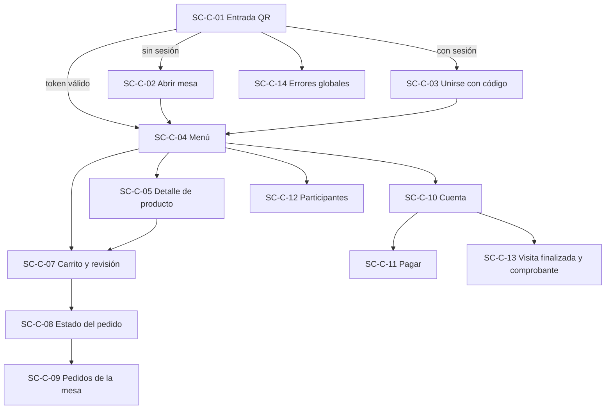
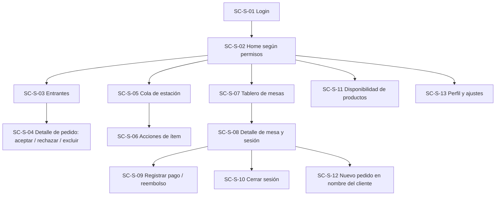

# Mapa de pantallas

Cada pantalla lista: casos de uso, **datos** que consume (endpoints), **estados** a diseñar y notas. Todas deben cubrir: cargando · vacío · error · sin conexión (salvo que se indique).

## 1. Web cliente (`SC-C-*`)

| ID | Pantalla | CU | Datos (endpoint) | Estados / notas |
|---|---|---|---|---|
| SC-C-01 | Entrada QR (resolver mesa) | CU-01/04 | `GET /public/tables/{code}`, `GET /sessions/current` | QR inválido, mesa no disponible, local cerrado, retomar |
| SC-C-02 | Abrir mesa (nombre) | CU-02 | `POST …/sessions` | Validación de nombre; carrera `SESSION_ALREADY_OPEN` |
| SC-C-03 | Unirse (nombre + código) | CU-03 | `POST …/join` | Código erróneo, bloqueo con cuenta regresiva, sesión llena |
| SC-C-04 | Menú (categorías + lista) | CU-05 | `GET /menu` (ETag) | Agotado, vacío, caché sin conexión, local cerrado (solo lectura) |
| SC-C-05 | Detalle de producto | CU-05/06 | `GET /products/{id}` | Alérgenos, nota, cantidad, agotado |
| SC-C-06 | (reservado: opciones/modificadores, Q-02) | — | — | — |
| SC-C-07 | Carrito y revisión | CU-06/07 | local + `POST …/orders` | Total estimado, `PRICE_CHANGED`, `PRODUCT_UNAVAILABLE`, enviando, límite de pendientes |
| SC-C-08 | Estado del pedido | CU-08/09/10 | `GET /orders/{id}` (+SSE) | PENDING_REVIEW (con tiempo), ACCEPTED/IN_PREPARATION/READY/DELIVERED, REJECTED (motivo + corregir), EXPIRED, CANCELLED, exclusiones |
| SC-C-09 | Pedidos de la mesa | CU-08 | `GET /sessions/current/orders` | Quién pidió qué; vacío |
| SC-C-10 | Cuenta compartida | CU-11 | `GET …/bill` | Cargos, pagos, saldo, "pedidos pendientes no incluidos", saldo a favor |
| SC-C-11 | Pagar (simulado) | CU-12 | `POST …/payments` | Total / parcial / mi parte (divisor UI), **sin campos de tarjeta**, rechazo demo, excede saldo |
| SC-C-12 | Participantes y código | CU-13 | `GET …/participants` | Host: revocar/rotar; compartir código |
| SC-C-13 | Visita finalizada + comprobante | CU-04/14 | `GET …/receipt.pdf` | Ventana 24 h, vencido |
| SC-C-14 | Errores globales | — | — | Acceso retirado, sesión no encontrada, sin conexión, servidor dormido (arranque en frío) |
| SC-C-15 | Login/registro (F9) | CU-60 | `/auth/*` | — |
| SC-C-16 | Encuesta (F9) | CU-61 | — | — |

## 2. App Android del personal (`SC-S-*`)

| ID | Pantalla | CU | Datos | Estados / notas |
|---|---|---|---|---|
| SC-S-01 | Login | CU-20 | `/auth/login` | Credenciales inválidas, bloqueo, cambio de contraseña obligatorio |
| SC-S-02 | Home (pestañas por permisos) | CU-20 | `/me` | Pestañas visibles según `permissions` |
| SC-S-03 | Entrantes | CU-21 | `GET /staff/orders` | Vacío ("Sin pedidos nuevos"), tiempo de espera, resaltado cerca del TTL, sonido/vibración opcional |
| SC-S-04 | Detalle de pedido | CU-22/23 | `GET /staff/orders/{id}` | Ítems con disponibilidad actual; excluir con motivo; `ORDER_ALREADY_DECIDED` (mostrar quién decidió) |
| SC-S-05 | Cola de estación | CU-24 | `GET …/queue` | FIFO, `delayed`, notas destacadas, filtro por estado |
| SC-S-06 | Acciones de ítem | CU-25–28 | `…/start·ready·deliver·cancel·undo` | Confirmación en cancelar (motivo), deshacer, errores de transición |
| SC-S-07 | Tablero de mesas | CU-29 | `GET /staff/tables` | 6 `displayStatus`, contador de pendientes, saldo (F7) |
| SC-S-08 | Detalle de mesa/sesión | CU-26/29/13 | `GET /staff/sessions/{id}` | Pedidos, cuenta, participantes, código; entregar listos |
| SC-S-09 | Pago en caja / reembolso | CU-32/33 | `/staff/…/payments`, `/refunds` | Saldo, saldo a favor |
| SC-S-10 | Cerrar sesión | CU-34/35 | `…/close`, `…/force-close` | Checklist de impedimentos, forzar (solo con permiso + motivo) |
| SC-S-11 | Disponibilidad | CU-36 | `GET /menu` + `PATCH …/availability` | Búsqueda, toggle inmediato con rollback si falla |
| SC-S-12 | Nuevo pedido a nombre del cliente | CU-31 | `POST …/orders` | Selector de productos |
| SC-S-13 | Perfil/ajustes | CU-20 | — | Cerrar sesión, sonido/vibración |
| SC-S-14 | Estados globales | — | — | Offline, sesión expirada, error de servidor |

## 3. Panel de administración (`SC-A-*`)

| ID | Pantalla | CU | Notas |
|---|---|---|---|
| SC-A-01 | Login | CU-20 | Rutas protegidas; carga diferida del chunk admin |
| SC-A-02 | Dashboard | CU-43 | Ventas del día, pedidos activos, tiempos, tasa de rechazo |
| SC-A-03 | Pedidos y sesiones (lista + detalle) | CU-29 | Filtros, cursor |
| SC-A-04 | Catálogo (categorías y productos) | CU-40 | Reordenar, archivar, disponibilidad |
| SC-A-05 | Editor de producto | CU-40 | Imagen + alt, alérgenos, estación, `OPTIMISTIC_LOCK_FAILED` |
| SC-A-06 | Mesas y QR | CU-41 | Regenerar QR (con advertencia), hoja imprimible |
| SC-A-07 | Usuarios | CU-42 | Alta, roles, estaciones, deshabilitar |
| SC-A-08 | Roles (solo lectura en MVP) | CU-42 | Matriz de permisos |
| SC-A-09 | Reportes | CU-43 | Rango de fechas, exportar PDF |
| SC-A-10 | Auditoría | CU-44 | Filtros y detalle |
| SC-A-11 | Ajustes del local | CU-45 | Horarios, límites, textos de comprobante |

## 4. Rutas (Web)
| Ruta | Pantalla |
|---|---|
| `/t/:tableCode` | SC-C-01 |
| `/mesa/abrir`, `/mesa/unirse` | SC-C-02, 03 |
| `/menu`, `/menu/p/:productId` | SC-C-04, 05 |
| `/carrito` | SC-C-07 |
| `/pedidos`, `/pedidos/:id` | SC-C-09, 08 |
| `/cuenta`, `/cuenta/pagar` | SC-C-10, 11 |
| `/participantes` | SC-C-12 |
| `/fin` | SC-C-13 |
| `/admin/*` | SC-A-* (lazy) |

## 5. Navegación Android (resumen)
`Login → Home(bottom nav: Entrantes · Estación(es) · Mesas · Disponibilidad · Más)`; el contenido de la barra depende de `permissions` y `stations` de `/me`.

## 6. Etiquetas visibles para estados (es-AR)

| Estado | Etiqueta cliente | Etiqueta personal | Ícono sugerido |
|---|---|---|---|
| `PENDING_REVIEW` | Esperando confirmación | Nuevo | reloj |
| `ACCEPTED` | Confirmado | En cola | check |
| `IN_PREPARATION` | En preparación | En preparación | llama/taza |
| `READY` | Listo | Listo para entregar | campana |
| `DELIVERED` | Entregado | Entregado | doble check |
| `REJECTED` | No pudimos aceptarlo | Rechazado | x |
| `CANCELLED` | Cancelado | Cancelado | tachado |
| `EXPIRED` | Sin respuesta, podés reenviarlo | Vencido | reloj tachado |
| Mesa `FREE` / `OCCUPIED` / `PENDING_ORDERS` / `IN_SERVICE` / `AWAITING_PAYMENT` / `READY_TO_CLOSE` | — | Libre / Ocupada / Pedidos pendientes / En servicio / Esperando pago / Lista para cerrar | — |

> Estas etiquetas viven en el archivo de textos de cada app (no dentro de componentes).

## 7. Cambios de la v0.2
| Pantalla | Cambio |
|---|---|
| SC-C-04/05 | Selector de idioma; hoja de **opciones** (SC-C-06 deja de estar reservada); placeholder de imagen |
| SC-C-07 | Líneas por combinación de opciones; mensajes `OPTION_*` |
| SC-C-10 | Ajustes con etiqueta genérica y propinas aparte |
| SC-C-11 | **Propina libre** (campo + ayudas), pago solo propina |
| SC-C-09 / nuevo SC-C-17 | Botón **Llamar al mozo** con motivos |
| SC-S-05/06 | Opciones visibles en cada ítem |
| SC-S-07 | Insignia de llamados al mozo (F9) |
| SC-S-08 | Acción **Aplicar ajuste** (tipo, monto o ítem, motivo) |
| SC-S-11 | Disponibilidad de **opciones** |
| SC-A-04/05 | Grupos de opciones, asignación a productos, traducciones |
| SC-A-09 | Reportes de propinas y descuentos |
