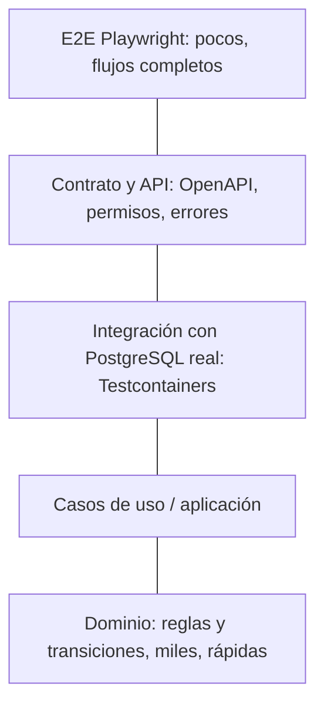

# Estrategia de pruebas

> Una pantalla visualmente terminada **no** es una funcionalidad terminada. Las pruebas existen para que las reglas no se rompan en silencio.

## 1. Pirámide y herramientas



| Capa | Qué comprueba | Herramientas |
|---|---|---|
| Dominio (backend) | Reglas, transiciones, derivación de estado (incluye pruebas de propiedades) | JUnit 5 (+ jqwik opcional) |
| Aplicación | Casos de uso, orquestación, permisos | JUnit 5, MockK |
| Integración backend | Persistencia, locks, restricciones, idempotencia | Testcontainers PostgreSQL |
| API/contrato | Esquemas, errores, permisos por rol | `@WebMvcTest`, swagger-request-validator |
| Arquitectura | Capas, ciclos, aislamiento de módulos | ArchUnit |
| Concurrencia | Carreras (ver receta en `idempotencia-concurrencia.md`) | Testcontainers + hilos |
| Web unit/UI | Lógica (carrito, formateo) y componentes | Vitest + React Testing Library + MSW |
| Web E2E | Flujos reales en navegador | Playwright |
| Android unit | ViewModels, reglas de UI, mappers | JUnit, MockK, Turbine |
| Android UI | Pantallas y navegación | Compose UI Test |
| Android red | Contrato con fixtures | MockWebServer |
| Seguridad | Acceso no autorizado, IDOR, rate limit | Tests de API + checklist |
| Rendimiento | Presupuestos (ver §5) | Lighthouse, Android Studio Profiler, k6 |
| Accesibilidad | Contraste, foco, etiquetas | axe (web), Accessibility Scanner (Android) |

## 2. Principios
1. **Cada `RN-*`, `CL-*` y `ERROR_CODE` tiene al menos una prueba** con ese ID en el nombre. Trazabilidad en `criterios-aceptacion.md`.
2. Un test debe **fallar** si se rompe la regla (probar rompiéndola una vez).
3. Preferir pocas pruebas E2E bien elegidas + muchas de dominio.
4. Las pruebas de integración usan **PostgreSQL real**, no H2 (los índices parciales y locks se comportan distinto).
5. Pruebas deterministas: `Clock` inyectado, sin `sleep` arbitrarios, datos propios por prueba.
6. Nunca se prueba solo el camino feliz: cada caso de uso prueba éxito + cada error de su lista.
7. Pruebas de permisos **parametrizadas** sobre la matriz `rol × permiso` (`actores-y-roles.md`): una celda = un caso.
8. Pruebas de transiciones inválidas generadas desde las tablas de `estados-y-transiciones.md`.

## 3. Datos de prueba
- Fábricas/builders por entidad (backend y clientes).
- Dataset demo (`db/seed-dev`) para E2E: menú reducido, 4 mesas, usuarios por rol.
- Reset de base entre E2E (truncate o contenedor limpio).

## 4. Flujos E2E (Playwright + backend real)

| ID | Flujo | Cubre |
|---|---|---|
| E2E-01 | QR → abrir sesión → menú → pedido → aparece pendiente | CU-01/02/05/07 |
| E2E-02 | Segundo participante se une con código y ve el pedido | CU-03/08 |
| E2E-03 | Personal acepta → cliente ve "Confirmado" | CU-22/08 |
| E2E-04 | Rechazo con motivo → cliente corrige y reenvía | CU-23/10 |
| E2E-05 | Preparación por estación hasta entregado | CU-24–26 |
| E2E-06 | Cuenta → dos pagos parciales → saldo 0 → cierre | CU-11/12/34 |
| E2E-07 | Doble clic en enviar/pagar → un solo efecto | CL-002/005 |
| E2E-08 | Recarga de página en medio del flujo → retoma sesión | CU-04 |
| E2E-09 | Sesión cerrada → comprobante PDF descargable | CU-14 |
| E2E-10 | Dueño cambia precio → pedidos viejos conservan precio | CL-114 |

Android: pruebas de UI por pantalla + un flujo instrumentado de punta a punta contra backend local (WP-QA).

## 5. Presupuestos de rendimiento (objetivos 🟡)
| Medida | Objetivo |
|---|---|
| Web cliente: LCP en móvil 4G | < 2,5 s |
| Web cliente: JS inicial | < 200 KB gzip |
| Web: CLS | < 0,1 |
| API `GET /menu` p95 (con ETag) | < 150 ms |
| API escritura crítica p95 | < 400 ms |
| Android: arranque en frío | < 2 s |
| Android: scroll de listas | sin jank apreciable (60 fps) |
| SSE: conexiones simultáneas estables | ≥ 50 |

## 6. Puertas de calidad en CI
| Puerta | Bloquea merge |
|---|---|
| Compilación + lint + tipos | Sí |
| Pruebas unitarias y de integración | Sí |
| ArchUnit | Sí |
| Contrato (swagger-request-validator + Spectral) | Sí |
| Cobertura de dominio ≥ 90 % (líneas) | Sí |
| gitleaks (secretos) | Sí |
| E2E (Playwright) | Sí en `main`, opcional en PR |
| Auditoría de dependencias | Informativa |

## 7. Plantilla de caso de prueba
```
ID: CL-020-accept-concurrent
Referencias: CU-22, RN-ORD-08, ORDER_ALREADY_DECIDED
Dado un pedido PENDING_REVIEW
Cuando dos usuarios con order.accept lo aceptan a la vez
Entonces exactamente uno recibe 200, el otro 409 ORDER_ALREADY_DECIDED
 Y existe una sola auditoría ORDER_ACCEPTED
```
