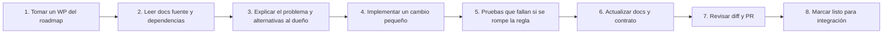

# Agentes y colaboración

El proyecto se trabaja con **agentes especializados** (IA como pareja de programación, D-014) coordinados por el dueño del proyecto. Cada agente tiene responsabilidades, entradas y salidas claras.

| Agente | Guía | Posee |
|---|---|---|
| **Arquitecto / orquestador** | `arquitecto.md` | Decisiones, ADRs, dominio, contrato OpenAPI, coherencia entre agentes |
| **Backend** | `backend.md` | `backend/`: reglas, permisos, persistencia, API, idempotencia, jobs, PDF/email, SSE |
| **Web** | `web.md` | `web/`: cliente (QR) y panel `/admin` |
| **Android** | `android.md` | `android/`: app del personal |
| **UX/UI** | `ux-ui.md` | Sistema visual, wireframes, tokens, componentes, assets |
| **QA** | `qa.md` | Estrategia, escenarios, E2E, concurrencia, rendimiento, accesibilidad |
| **DevOps / Docs** | `devops.md` | Infra local, CI/CD, nube, higiene del repo |

Transversales: `dependencias.md` (quién necesita qué de quién) y `roadmap-fases.md` (paquetes de trabajo `WP-*` ordenados).

## Cómo trabaja un agente en cada tarea (ciclo)



## Reglas de colaboración (de la sección 19 del plan maestro)
1. Una decisión o un caso de uso por vez.
2. Antes de implementar: explicar problema y alternativas.
3. Cambios pequeños y revisables; explicar la responsabilidad de cada archivo y capa.
4. Entender qué verifica cada prueba.
5. Revisar el diff antes de confirmar en Git.
6. No introducir librerías sin explicar qué necesidad resuelven.
7. No aceptar abstracciones solo porque suenan profesionales.
8. Docs y ADRs al día.
9. Si una explicación es demasiado rápida, detenerse y dividirla.

## Plantilla de entrega de un WP
```
WP: WP-BE-41
Qué se hizo: …
Por qué así (alternativas): …
Archivos tocados y responsabilidad: …
Reglas/CU/CL cubiertos: RN-ORD-01…, CU-07, CL-001…
Pruebas: … (qué verifican)
Contrato/errores afectados: … (CHANGELOG actualizado: sí/no)
Listo para integración con: Web / Android (qué endpoint, qué mock reemplaza)
Pendientes / riesgos: …
```
