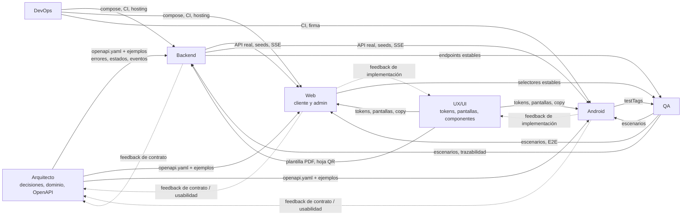

# Dependencias entre agentes

> Regla central: **contrato primero**. Nadie bloquea a nadie si el contrato (`openapi.yaml` con ejemplos) está acordado: Web y Android avanzan con mocks mientras Backend implementa.

## 1. Mapa de dependencias

Línea sólida = entrega obligatoria · punteada = retroalimentación.

## 2. Qué necesita cada agente de los otros (y qué hace mientras espera)

| Consumidor | Necesita | Proveedor | "Listo" significa | Plan B mientras no está |
|---|---|---|---|---|
| Backend | `openapi.yaml` del módulo, errores y estados | Arquitecto | Esquema + ejemplos + errores | Implementar **dominio y transiciones** (no dependen del contrato HTTP) |
| Web | Contrato + ejemplos | Arquitecto | `openapi.yaml` v0.1 publicado | Maquetar con tokens y datos MSW |
| Web | API real del módulo | Backend | Endpoint en local/demo que pasa test de contrato | **Prism** / MSW |
| Web | Tokens y pantallas | UX | Archivos publicados | Usar tokens provisorios del `sistema-visual.md` |
| Android | Contrato + ejemplos | Arquitecto | Igual que Web | Repositorios *fake* + MockWebServer |
| Android | Auth staff, colas, transiciones | Backend | Endpoints en local | Prism |
| Android | SSE | Backend | `GET /events/stream` operativo | Polling cada 5 s |
| Backend | Plantilla de comprobante | UX | Diseño del PDF | Plantilla simple provisional |
| Todos | Entorno reproducible y CI | DevOps | `docker compose up` + CI verde | Instalación manual documentada |
| QA | Endpoints y datos estables | Backend | Seeds determinísticos | Pruebas de dominio/unitarias primero |
| Web/Android | Decisión de marca (logo, tipografía) | Dueño/UX | Q-06 resuelta | Tipografía provisoria |
| Backend | Respuesta a consultas de regla | Arquitecto | Entrada resuelta en `decisiones.md` §5 | Otra tarea del roadmap |

## 3. Dependencias por caso de uso (quién toca qué)

| CU | Backend | Web | Android | UX | Bloqueo principal |
|---|:-:|:-:|:-:|:-:|---|
| CU-01 Escanear QR | ✔ | ✔ | — | ✔ | Web ← Backend (`/public/tables/{code}`) |
| CU-02 Abrir sesión | ✔ | ✔ | — | ✔ | Web ← Backend |
| CU-03 Unirse | ✔ | ✔ | — | ✔ | Web ← Backend |
| CU-05/06 Menú y carrito | ✔ | ✔ | — | ✔ | Web ← Backend `/menu` (mock posible) |
| CU-07 Enviar pedido | ✔ | ✔ | — | ✔ | Web ← Backend (idempotencia, PRICE_CHANGED) |
| CU-08/09/10 Seguir/cancelar/reenviar | ✔ | ✔ | — | ✔ | Polling primero, SSE en F6 |
| CU-20 Login staff | ✔ | (admin) | ✔ | ✔ | Android ← Backend auth |
| CU-21/22/23 Entrantes, aceptar, rechazar | ✔ | — | ✔ | ✔ | Android ← Backend (F4 API, F5 UI) |
| CU-24/25/26 Colas y preparación | ✔ | — | ✔ | ✔ | Android ← Backend F5 |
| CU-29 Tablero | ✔ | — | ✔ | ✔ | Backend derivación `displayStatus` |
| CU-11/12 Cuenta y pago | ✔ | ✔ | — | ✔ | Web ← Backend F7 |
| CU-32/33/34/35 Caja y cierre | ✔ | — | ✔ | ✔ | Android ← Backend F7 |
| CU-14 Comprobante PDF | ✔ | ✔ | — | ✔ | Plantilla UX → Backend |
| CU-40…45 Admin | ✔ | ✔ | — | ✔ | Web ← Backend F8 |
| CU-52 Eventos | ✔ | ✔ | ✔ | — | Web/Android ← Backend F6 |

## 4. Protocolo de integración (handoff)

**Backend → Web/Android ("listo para integrar")**
1. Endpoint implementado y desplegado local/demo.
2. Test de contrato verde; ejemplos del OpenAPI **actualizados con respuestas reales**.
3. Colección Bruno con el caso feliz y los errores principales.
4. Semillas demo disponibles.
5. Aviso en el PR: "listo para integración con Web/Android, reemplaza mock X".

**Web/Android → Backend (feedback)**
- Si el contrato es incómodo (falta un campo, una paginación, un error), **abrir consulta**; no hacer *workarounds* en el cliente.

**Cambio de contrato**
1. Propuesta (consulta) → 2. Arquitecto decide (compatible / incompatible) → 3. Se actualiza `openapi.yaml` + `CHANGELOG` → 4. Backend y clientes adaptan en PRs coordinados → 5. Prism y MSW se actualizan.
- Compatible: campos opcionales nuevos, errores nuevos, endpoints nuevos.
- Incompatible: renombrar/quitar/cambiar semántica → versión nueva.

## 5. Camino crítico del MVP

```mermaid
flowchart LR
  A[Fase 0<br/>validar docs] --> B[Fase 1<br/>OpenAPI + dominio]
  B --> C[Fase 2<br/>base técnica + esqueleto desplegado]
  C --> D[Fase 3<br/>catálogo + web menú]
  D --> E[Fase 4<br/>QR, sesiones, pedidos, aceptar vía API]
  E --> F[Fase 5<br/>Android staff + preparación]
  F --> G[Fase 6<br/>tiempo real + concurrencia]
  G --> H[Fase 7<br/>cuenta, pagos, cierre, PDF]
  H --> I[Fase 8<br/>admin + reportes]
  I --> J[Fase 9<br/>extras]
  J --> K[Fase 10<br/>demo + portfolio]
```

**Trabajo paralelo posible**
- F1: Arquitecto (OpenAPI) ∥ UX (tokens/wireframes) ∥ Backend (dominio puro) ∥ QA (escenarios).
- F3: Backend (catálogo) ∥ Web (menú con mock) ∥ UX (pantallas SC-C-04/05/07).
- F4: Backend (floor/orders/identity) ∥ Web (QR/sesión/pedido con Prism).
- F5: Backend (preparation) ∥ Android (login/entrantes con Prism) ∥ UX.
- F8: Backend (admin) ∥ Web (panel con Prism).

## 6. Riesgos de integración y mitigaciones
| Riesgo | Mitigación |
|---|---|
| Cada agente inventa nombres | Enums/códigos únicos en OpenAPI; generación de tipos; pruebas de contrato |
| Mock distinto al backend real | Ejemplos del OpenAPI actualizados con respuestas reales; E2E contra backend real en `main` |
| Cambios de contrato sin aviso | `CHANGELOG` obligatorio + CI de contrato |
| Cliente decide lo que debe decidir el servidor | Checklist de PR; QA prueba manipulación de payloads |
| Fase 6 introduce inconsistencias | Eventos como pistas + reconsulta (nunca estado crítico en el evento) |
