# Roadmap por fases y paquetes de trabajo (WP)

> El alcance total está planificado; la entrega es incremental. **Medida de avance:** flujos completos funcionando, probados y demostrables, no archivos creados.
> Formato: `WP-AGENTE-nn` · **Dep.** = prerrequisitos · **DoD** = condición de terminado · Agentes: ARQ, UX, BE, WEB, AND, QA, OPS.

```mermaid
gantt
  title Fases (orden y dependencias; sin fechas fijas)
  dateFormat  X
  axisFormat  %s
  section Definición
  F0 Especificación        :f0, 0, 1
  F1 Dominio y contratos   :f1, after f0, 2
  section Base
  F2 Base técnica + esqueleto :f2, after f1, 2
  section Núcleo
  F3 Catálogo y web        :f3, after f2, 3
  F4 QR, sesiones, pedidos :f4, after f3, 4
  F5 Android personal      :f5, after f4, 4
  F6 Tiempo real           :f6, after f5, 2
  F7 Cuenta, pagos, PDF    :f7, after f6, 4
  section Ampliación
  F8 Admin y reportes      :f8, after f7, 4
  F9 Extras                :f9, after f8, 3
  F10 Nube y portfolio     :f10, after f9, 2
```

*(Las unidades del gráfico son relativas; no representan semanas ni compromisos de fecha.)*

---
## Fase 0 — Especificación funcional
**Salida:** reglas críticas de pedido, sesión y saldo sin ambigüedad; decisiones validadas.
| WP | Descripción | Dep. | DoD |
|---|---|---|---|
| WP-ARQ-00 | Validar con el dueño `decisiones.md` (D-1xx) y resolver Q-02, Q-09 mínimo | Este paquete | Todas las D-1xx marcadas aceptada/cambiada; Q de F1–F3 resueltas |
| WP-ARQ-01 | Ajustar docs según cambios pedidos | WP-ARQ-00 | Docs v0.2 consistentes |

## Fase 1 — Dominio y contratos
**Salida:** Backend, Web y Android pueden desarrollar contra un contrato acordado.
| WP | Agente | Descripción | Dep. | DoD |
|---|---|---|---|---|
| WP-ARQ-10 | ARQ | `openapi.yaml` v0.1: núcleo (menú, acceso/sesión, pedidos, staff pedidos/colas, errores, eventos) con **ejemplos**. **v0.2:** incluye opciones/modificadores, `Accept-Language`, propina en pagos, ajustes de cuenta y llamados al mozo | WP-ARQ-01 | Redocly limpio; Prism lo sirve; revisado con Web y Android |
| WP-ARQ-11 | ARQ | ADRs finales (0001–0009) aceptados; plantilla ADR | WP-ARQ-01 | Estado `aceptada` |
| WP-ARQ-12 | ARQ | Colecciones Bruno del caso feliz y errores | WP-ARQ-10 | En `docs/04-api/bruno/` |
| WP-UX-10 | UX | Identidad (Q-06), `design-tokens.json`, contraste AA verificado | WP-ARQ-01 | Tokens publicados |
| WP-UX-11 | UX | Wireframes de baja fidelidad de todas las pantallas/superficies de `docs/05-diseno/mapa-pantallas.md`, matriz de cobertura y plantillas de estados aplicables | WP-UX-10 | Cada pantalla vigente aparece en la matriz y tiene wireframe; estados de carga, vacío, error y sin conexión cubiertos según corresponda; sin implementar UI ni inventar reglas |
| WP-BE-10 | BE | **Dominio puro** en Kotlin: `Order/OrderItem`, `recalculateStatus`, `TableSession`, `Payment`/`Bill`, VO (`Money`, `JoinCode`) con pruebas (incluye propiedades) | `estados-y-transiciones.md` | Dominio ≥ 90 % cubierto; tablas de transición verificadas |
| WP-QA-10 | QA | Plan de pruebas, escenarios Gherkin de CU núcleo, generador de matriz de transiciones inválidas | Docs de dominio | `06-pruebas` ampliado |

## Fase 2 — Base técnica
**Salida:** las piezas arrancan reproduciblemente; la base se crea por migraciones; esqueleto desplegado.
| WP | Agente | Descripción | Dep. | DoD |
|---|---|---|---|---|
| WP-OPS-20 | OPS | Monorepo, `.gitattributes`, `.gitignore`, compose (PostgreSQL, Mailpit, Prism), `.env.example`, plantillas PR/issue | — | `docker compose up` OK en Windows limpio |
| WP-OPS-21 | OPS | CI: backend, web, android, docs (Redocly, markdownlint), gitleaks | WP-OPS-20 | Workflows verdes |
| WP-BE-20 | BE | Esqueleto Spring Boot + Kotlin, perfiles, Actuator, `/version`, manejador Problem+JSON, `Clock`, Testcontainers, ArchUnit base | WP-OPS-20 | `./gradlew check` verde |
| WP-BE-21 | BE | Flyway V1: restaurante, settings, permisos, roles, estaciones; semilla obligatoria | WP-BE-20 | Migra desde cero |
| WP-WEB-20 | WEB | Esqueleto Vite+React+TS, router, providers, tokens CSS, i18n (es-AR + en, textos por clave), cliente API generado, MSW, ESLint boundaries, Vitest | WP-ARQ-10, WP-UX-10 | `pnpm check` verde; pantalla "hola" contra Prism |
| WP-AND-20 | AND | Esqueleto Compose, tema (tokens), Hilt, Retrofit, Navigation, módulo `core`, tests | WP-ARQ-10, WP-UX-10 | App abre y llama a `/version` (Prism/backend) |
| WP-OPS-22 | OPS | **Esqueleto caminante desplegado** (HTTPS, variables, CORS, base) | WP-BE-20, WP-WEB-20 | URL pública muestra `/version` desde la web |
| WP-ARQ-20 | ARQ | ADR de despliegue: web en **Vercel** (D-133); elegir host de backend + PostgreSQL (Q-15) | WP-OPS-22 | ADR aceptada |

## Fase 3 — Catálogo y web del cliente
**Salida:** un cliente explora un menú real desde el móvil.
| WP | Agente | Descripción | Dep. | DoD |
|---|---|---|---|---|
| WP-UX-30 | UX | Alta fidelidad SC-C-04/05/07 (+estados) y componentes de producto/carrito | WP-UX-11 | Publicado |
| WP-UX-31 | UX | Hoja de selección de opciones, selector de idioma, placeholder de imagen; logo desde `design/img/` | WP-UX-10 | Publicado |
| WP-BE-30 | BE | Módulo `catalog`: migración, `GET /menu` con ETag, `GET /products/{id}`, semilla demo | WP-BE-21, WP-ARQ-10 | Test de contrato verde |
| WP-BE-32 | BE | **Opciones:** grupos reutilizables, asignación a productos, traducciones, `GET /menu` con `optionGroups` y `Accept-Language`, disponibilidad de opciones | WP-BE-30 | RN-OPT-01…11, RN-I18N-03/04; CL-170…178, 210/213 |
| WP-BE-33 | BE | Puerto `ImageStorage` + adaptador de carpeta (`/media`), imágenes de demo en seed | WP-BE-30 | RN-IMG-01…05; CL-214 |
| WP-WEB-30 | WEB | Menú (SC-C-04/05), carrito local (Zustand), límites, estados, caché sin conexión; con **Prism/MSW** | WP-WEB-20, WP-UX-30 | Navegación y estados completos |
| WP-WEB-31 | WEB | Integración con API real del menú | WP-BE-30 | E2E de menú verde |
| WP-WEB-32 | WEB | Opciones en detalle de producto y carrito (líneas distintas por opciones), **i18n es-AR/en** con selector, placeholder de imagen | WP-WEB-31, WP-BE-32, WP-UX-31 | AC-CU-47-a; CL-212 |
| WP-QA-30 | QA | Pruebas de menú, accesibilidad y rendimiento (presupuestos) | WP-WEB-31 | Lighthouse y axe dentro de umbrales |
| WP-ARQ-30 | ARQ | Cerrar Q-16 (idiomas/traducción de menú) y verificar lista de alérgenos contra el CAA (D-137). Q-02 ya resuelta: opciones en MVP | — | Resuelto; contrato con opciones e i18n incluido en `openapi.yaml` v0.1 |

## Fase 4 — Mesas, sesiones, QR y pedidos
**Salida:** pedido persistente que sobrevive a un reinicio y cumple reglas del servidor; aceptación vía API.
| WP | Agente | Descripción | Dep. | DoD |
|---|---|---|---|---|
| WP-BE-40 | BE | `floor`: mesas, sesiones, participantes, QR resolve/open/join, joinCode, tokens hasheados, índice único parcial, rate limit de código, job de sesión vacía | WP-BE-21, WP-BE-10 | AC-CU-02/03; CL-027/040/041/042/044 |
| WP-BE-41 | BE | `shared`: idempotencia (registro, hash, replay, in-progress) | WP-BE-20 | CL-001/003/004/009 |
| WP-BE-42 | BE | `orders`: crear pedido (snapshot, PRICE_CHANGED, límites, `displayCode`), consultar, cancelar, job de expiración | WP-BE-40, WP-BE-41, WP-BE-30 | AC-CU-07/08/09; CL-060…070 |
| WP-BE-46 | BE | Aislamiento por restaurante: filtro `restaurantId` + pruebas con **dos restaurantes** sembrados | WP-BE-40 | RN-TEN-01/02; CL-215 |
| WP-BE-43 | BE | `identity` mínimo: login staff, refresh rotativo, `/me`, permisos, seed de usuarios demo, cambio de contraseña | WP-BE-21 | AC-CU-20; CL-120…124 |
| WP-BE-44 | BE | Aceptar/rechazar/aceptar con exclusiones; concurrencia (`ORDER_ALREADY_DECIDED`) | WP-BE-42, WP-BE-43 | AC-CU-22/23; CL-020…022 |
| WP-BE-45 | BE | `audit` base (misma tx) | WP-BE-42 | RN-AUD-01…05 |
| WP-UX-40 | UX | Alta fidelidad SC-C-01/02/03/08/09/12/14 | WP-UX-11 | Publicado |
| WP-WEB-40 | WEB | Entrada QR, abrir/unirse, retomar, sesión; token; errores globales (con Prism) | WP-WEB-31, WP-UX-40, WP-ARQ-10 | AC-CU-02/03/04 |
| WP-WEB-41 | WEB | Enviar pedido (idempotencia, PRICE_CHANGED, PRODUCT_UNAVAILABLE), estado del pedido por polling, cancelar, corregir y reenviar, participantes | WP-WEB-40 | AC-CU-07/08/09/10 |
| WP-WEB-42 | WEB | Integración con API real de sesión/pedidos | WP-BE-40, WP-BE-42 | E2E-01/02/08 |
| WP-QA-40 | QA | Concurrencia (CL-020…027), idempotencia, seguridad (IDOR, fuerza bruta de código), E2E-01…04 con Bruno para aceptar | WP-BE-44, WP-WEB-42 | Verde |

## Fase 5 — App Android del personal
**Salida:** el personal opera el flujo principal desde Android.
| WP | Agente | Descripción | Dep. | DoD |
|---|---|---|---|---|
| WP-UX-50 | UX | Alta fidelidad SC-S-01…14 | WP-UX-11 | Publicado |
| WP-BE-50 | BE | `preparation`: estaciones asignadas, colas FIFO, `delayed`, endpoints `start/ready/deliver/cancel/undo`, `deliver-ready`, derivación de estado del pedido | WP-BE-44 | AC-CU-24…28; CL-028/029/080…088 |
| WP-BE-51 | BE | Tablero `GET /staff/tables` (`displayStatus`), detalle de sesión, abrir sesión manual, revocar/rotar código | WP-BE-50, WP-BE-40 | AC-CU-29/30 |
| WP-BE-52 | BE | `PATCH /staff/products/{id}/availability` + `catalogVersion` | WP-BE-30 | CU-36 |
| WP-AND-50 | AND | Login, `/me`, pestañas por permisos, refresh con mutex, almacenamiento cifrado | WP-AND-20, WP-UX-50 | AC-CU-20-* |
| WP-AND-51 | AND | Entrantes y detalle (aceptar/rechazar/excluir), manejo de `ORDER_ALREADY_DECIDED` | WP-AND-50 | AC-CU-22/23 |
| WP-AND-52 | AND | Colas por estación y acciones de ítem | WP-AND-50 | AC-CU-24…28 |
| WP-AND-53 | AND | Tablero y detalle de mesa; disponibilidad de productos | WP-AND-50 | CU-29/36 |
| WP-AND-54 | AND | Integración real con backend (cambiar de Prism a backend) | WP-BE-50…52 | Flujo instrumentado verde |
| WP-QA-50 | QA | Matriz permisos×rol, transiciones inválidas, E2E-05, pruebas instrumentadas Android | WP-AND-54 | Verde |

## Fase 6 — Tiempo real y robustez
**Salida:** cambios reflejados en interfaces abiertas; recuperación de desconexiones.
| WP | Agente | Descripción | Dep. | DoD |
|---|---|---|---|---|
| WP-ARQ-60 | ARQ | Aprobada por D-160: ADR-0006 adopta PostgreSQL outbox + SSE, cursor por restaurante, versión monotónica por agregado y revalidación | WP-BE-50 | ✅ Resolución aprobada; implementación corresponde a WP-BE-60 |
| WP-BE-60 | BE | Parcial en worktree: V15 `event_log`/cursor/versiones y productores transaccionales de pedido cliente/catálogo; falta endpoint SSE, retención y productores restantes | WP-ARQ-60 | RN-RT-01…06 |
| WP-WEB-60 | WEB | Cliente SSE (fetch stream), reconexión con backoff, dedupe, fallback a polling | WP-BE-60 | CL-140…143 |
| WP-AND-60 | AND | OkHttp-SSE, reconexión, dedupe, sonido/vibración opcional | WP-BE-60 | CL-140…144 |
| WP-QA-60 | QA | Reconexión, duplicados, desorden, 50 conexiones, concurrencia ampliada | WP-BE-60 | Verde |

## Fase 7 — Cuenta, pagos simulados y PDF
**Salida:** una visita completa se cierra con cuenta y pagos coherentes.
| WP | Agente | Descripción | Dep. | DoD |
|---|---|---|---|---|
| WP-ARQ-70 | ARQ | Resolver Q-01 (propina), Q-03 (descuentos), Q-08 (leyenda); ADR pagos simulados | — | Resuelta; ADR-0010 registra decisiones vigentes sin agregar reglas |
| WP-UX-70 | UX | SC-C-10/11/13, SC-S-09/10; plantilla del comprobante | WP-ARQ-70 | Publicado |
| WP-UX-71 | UX | Campo de propina libre (+ ayudas), pantalla de ajustes (SC-S-08/09), etiquetas de ajustes en cuenta y comprobante | WP-ARQ-70 | Publicado |
| WP-BE-70 | BE | `billing`: T02 de pagos simulados/efectivo completada localmente y validada; T01 parcial hasta exponer el puerto staff y cerrar reembolsos de T03; cuenta transaccional derivada, sin saldo duplicado | WP-BE-50 | AC-CU-11/12; CL-005/023/100…108 |
| WP-BE-71 | BE | Cierre de sesión (reglas + forzado), tokens a solo lectura, pedido a nombre del cliente | WP-BE-70 | AC-CU-34/35; CL-109…113 |
| WP-BE-72 | BE | Comprobante PDF no fiscal (`PdfRenderer`) | WP-BE-71, WP-UX-70 | RN-BIL-09 |
| WP-BE-73 | BE | **Propina** integrada a pagos; **ajustes** persistidos, idempotentes y reversión de cortesía al cancelar validadas; falta cerrar cobertura de permisos, tenant y concurrencia del ajuste | WP-BE-70 | RN-TIP-01…09, RN-ADJ-01…12; CL-180…198 |
| WP-WEB-70 | WEB | Cuenta, pagar (divisor UI), participantes, visita finalizada, descarga PDF | WP-BE-70, WP-UX-70 | AC-CU-11/12/14 |
| WP-WEB-71 | WEB | Propina libre en el pago, cuenta con ajustes y propinas | WP-BE-73, WP-UX-71 | AC-CU-12-g/h/i |
| WP-AND-70 | AND | Pago en caja, anular/reembolsar, cierre y cierre forzado, saldo en tablero | WP-BE-71 | AC-CU-32…35 |
| WP-AND-71 | AND | Aplicar/anular ajustes con límites y motivo; opciones visibles en colas; disponibilidad de opciones | WP-BE-73, WP-UX-71 | AC-CU-37/38 |
| WP-QA-70 | QA | E2E-06…09, concurrencia de pagos y cierre, carga ligera (k6) | WP-BE-72, WP-WEB-70, WP-AND-70 | Verde |

## Fase 8 — Panel administrativo y reportes
**Salida:** el dueño administra el sistema sin tocar la base.
| WP | Agente | Descripción | Dep. | DoD |
|---|---|---|---|---|
| WP-ARQ-80 | ARQ | Resolver Q-04 (imágenes), ADR de almacenamiento | — | Aceptada |
| WP-UX-80 | UX | SC-A-01…11, hoja QR imprimible | — | Publicado |
| WP-BE-80 | BE | Admin: CRUD catálogo + imágenes, mesas + regenerar QR, usuarios/roles/estaciones, settings | WP-ARQ-80 | AC-CU-40…42, 45 |
| WP-BE-82 | BE | Admin de grupos de opciones, asignación a productos y traducciones | WP-BE-80 | AC-CU-46 |
| WP-BE-81 | BE | `reporting`: ventas, top productos, pedidos por hora, tiempos de preparación, rechazos; export PDF; consulta de auditoría | WP-BE-71 | AC-CU-43/44 |
| WP-WEB-80 | WEB | Panel `/admin` (lazy): login, dashboard, catálogo, mesas+QR, usuarios, reportes, auditoría, ajustes | WP-BE-80, WP-UX-80 | Probado |
| WP-WEB-81 | WEB | Admin de opciones y traducciones; reportes de propinas y descuentos | WP-BE-82 | CU-43/46 |
| WP-QA-80 | QA | Permisos admin, `OPTIMISTIC_LOCK_FAILED`, E2E-10, regenerar QR | WP-WEB-80 | Verde |

## Fase 9 — Extras seleccionados por D-160 (cada uno justificado)
| WP | Agente | Descripción | Dep. |
|---|---|---|---|
| WP-BE-90 | BE | Registro/verificación/login de cliente y vinculación conforme a reglas/contrato por definir; `EmailSender` con configuración por entorno, sin proveedor inventado | Q-35, Q-36 |
| WP-BE-91 | BE | Email de comprobante y encuesta (`feedback`) después de BE-90 y de definir el envío según reglas aprobadas | WP-BE-90, Q-36 |
| WP-BE-92 | BE | **Llamar al mozo** (adelantable tras F6), retiro por mostrador (si se mantiene) | D-138, D-025 |
| WP-WEB-90 | WEB | Login/registro, historial, encuesta, llamar al mozo | WP-BE-90/91/92 |
| WP-AND-90 | AND | Notificación de "llamado al mozo"; FCM opcional | WP-BE-92 |
| WP-QA-90 | QA | Pruebas de email (Mailpit), privacidad, enumeración | — |

## Fase 10 — Nube y presentación de portfolio
**Salida:** otra persona puede entender, probar la demo y revisar cómo está construido.
| WP | Agente | Descripción | Dep. | DoD |
|---|---|---|---|---|
| WP-OPS-100 | OPS | Despliegue reproducible, HTTPS, secretos, base persistente, backups, reseteo demo, APK en Releases | F9 | Demo estable |
| WP-ARQ-100 | ARQ | README final, diagrama de arquitectura, decisiones técnicas, **lista honesta de limitaciones** | — | Publicado |
| WP-UX-100 | UX | Capturas, video/GIFs del recorrido, página de presentación | F9 | Material listo |
| WP-QA-100 | QA | Regresión completa, informe de calidad y rendimiento | F9 | Informe |

---
## Backlog transversal (cualquier fase)
- Revisión de dependencias, rotación de secretos, actualización de docs/ADRs.
- Retención de datos (Q-07), multi-sucursal (Q-14), impresión de comandas (Q-11), stock (Q-12), idioma adicional (Q-13).

## Orden recomendado dentro de una fase
`ARQ (contrato) → UX (diseño) → BE (implementación) ∥ WEB/AND (con mocks) → integración → QA → ARQ (puerta de fase)`

---
## Enmiendas v0.2
- **Fase 3 crece:** incluye opciones/modificadores, i18n e imágenes en carpeta (WP-BE-32/33, WP-WEB-32, WP-UX-31). Es la fase donde más cambia el alcance.
- **Fase 7 crece:** propina y ajustes (WP-BE-73, WP-WEB-71, WP-AND-71, WP-UX-71).
- **Llamar al mozo** (D-138) puede adelantarse a "Fase 6.5": necesita SSE para sentirse inmediato.
- **Multi-sucursal simulada:** WP-BE-46 desde la Fase 4, para no tener que reescribir permisos después.
